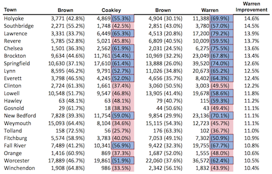

::: {.callout-note appearance="simple"}
Originally published on the [Mass. Numbers Blogger site](https://massnumbers.blogspot.com/2012/11/warren-realizes-largest-gains-in.html) on 2012-11-13.
:::

Martha Coakley's loss to Scott Brown in the January 19, 2010 special election to replace Senator Ted Kennedy was a shock to the Massachusetts political establishment. Scott Brown's dynamic campaign seemed to come from nowhere and catapulted him past Attorney General Coakley by winning favor with key Democratic constituencies including working-class families and rank-and-file union voters.

The Massachusetts Democratic Party vowed never to be caught napping again, and Elizabeth Warren's 54% to 46% victory over Senator Scott Brown on November 6, 2012 was a testament to that resolve. Conventional wisdom and polling results suggest that Warren's victory was due in part to a strong message of working-class populism and a fear of a Republican-controlled U. S. Senate, combined with an unprecedented ground game coordinated by the Warren campaign and the Massachusetts Democratic Party.

We examine the effect of Warren's campaign message and ground game through a municipal and geographic lens, highlighting towns and cities where Warren showed the largest gains compared to Coakley's 2010 results.

### The Map

```{r}
#| column: body-outset
#| fig-height: 6

library(tidyverse)
library(sf)
library(tmap)

tmap_mode("view")

# The spreadsheet repeats the "Brown" header for 2010 and 2012; the columns
# used here are the Coakley (2010) and Warren (2012) shares.
results <- read_csv("town_statewide_results.csv", show_col_types=FALSE,
                    name_repair="unique_quiet") |>
    transmute(TOWN=toupper(Town), Town,
              coakley=parse_number(Coakley),
              warren=parse_number(Warren),
              gain=warren - coakley,
              shade=pmax(gain, 0))

towns <- read_sf("../../_gis/townssurvey_shp/TOWNSSURVEY_POLYM.shp") |>
    st_transform(4326) |>
    left_join(results, by="TOWN")

tm_shape(towns) +
    tm_polygons(
        fill="shade",
        fill.scale=tm_scale_continuous(values=c("white", "#0F4392")),
        fill.legend=tm_legend(title="Warren 2012 minus Coakley 2010 (%)"),
        fill_alpha=0.7,
        col_alpha=0.3,
        id="Town",
        popup.vars=c("Coakley 2010 (%)"="coakley", "Warren 2012 (%)"="warren",
                     "Warren minus Coakley"="gain")) +
    tm_basemap("OpenStreetMap")
```

::: {.callout-note appearance="simple"}
**This map was rebuilt in 2026.** The original interactive map was made with
Google Fusion Tables, which Google shut down on 3 December 2019. This version is
drawn from the author's town-by-town [spreadsheet of statewide results](https://docs.google.com/spreadsheet/ccc?key=0AkWPTnj-k6-kdG5Xci1CWmQ3bDV3TFdlRXk5eVRmcmc&usp=sharing),
published with a January 2013 Mass. Numbers post, which gives each share to the
whole point; the chart below gives the original's figures to a tenth. Certified
results differ slightly from these election-week figures in a few towns.
:::

To examine the geographical and municipal changes from the 2010 special election and the 2012 presidential election we have color coded this map to show the percentage of the vote obtained by Martha Coakley in 2012, subtracted from the percentage of the vote obtained by Elizabeth Warren in 2012. The white-shaded municipalities are places where Martha Coakley out-performed Elizabeth Warren, and the darker the color blue, the higher the percentage Warren showed over Coakley.

Most of the municipalities where Elizabeth Warren showed the biggest percentage improvement are working-class cities like Fitchburg, Worcester, Springfield, Revere, New Bedford, Lowell, and Lawrence. Here is the chart of the top 21 municipalities where Elizabeth Warren outperformed Martha Coakley by the largest vote percentage:



Elizabeth Warren was able to realize 10-15% improvements in all of these municipalities, even moving from a losing position for Coakley in cities like Revere, Lowell, and Fitchburg, to a winning position for Warren in 2012.

It is striking that these large gains were realized throughout the Commonwealth, from Springfield and Holyoke in Western Massachusetts, to Fitchburg and Worcester in Central Massachusetts, Lowell and Lawrence in the Merrimack Valley, Lynn and Revere on the North Shore, to Brockton, Fall River, and New Bedford in the Southeast.

The key similarity between all these communities is their working-class demographics and the much larger voter turnout in the 2012 presidential election. The Warren campaign and the Massachusetts Democratic Party were obviously successful in communicating Warren's message and also getting their voters to the polls on November 6th. The ability of Elizabeth Warren to realize large gains in working-class cities was a large reason for her comfortable margin of victory.

Full dataset and map

::: {.callout-note appearance="simple"}
The full dataset and map were published with Google Fusion Tables and are no
longer available.
:::
