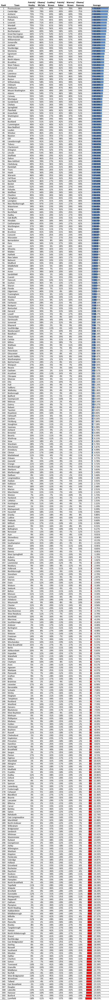
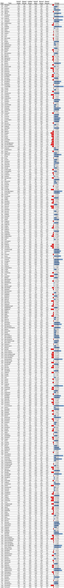

::: {.callout-note appearance="simple"}
Originally published on the [Mass. Numbers Blogger site](https://massnumbers.blogspot.com/2012/11/how-democratic-or-republic-is-my-town.html) on 2012-11-15.
:::

### A partisan ranking of MA municipalities from P-Town to Lynnfield

We often hear people say things like "Central Massachusetts is getting more conservative" and "Western Massachusetts is really blue" when discussing elections and politics. But what can we say from a quantitative point of view about the Democratic or Republican tendencies of various geographic areas of the Commonwealth?

While it is possible to look at the partisan voter registration records in each municipality, Massachusetts allows voters to register as unenrolled, and a majority of residents now register without party affiliation. A better gauge of the Democratic/Republican breakdown in a geographic area is the difference between the number of Democratic and Republic votes in actual elections.

I have collected the results of the statewide elections for Governor, Senator and President from 2006 through 2012 and averaged the difference between the percentage of the vote won by the Democrat, and the percentage of the vote won by the Republican. The results give an estimate of the Democratic/Republican lean of a municipality, with a large positive number indicating a larger percentage of Democratic votes, and a negative number indicating a greater percentage of Republic votes.

First the map:

```{r}
#| column: body-outset
#| fig-height: 6

library(tidyverse)
library(sf)
library(tmap)

tmap_mode("view")

pct <- function(x) parse_number(x)

town_lean <- read_csv("town_partisan_ranking.csv", show_col_types=FALSE) |>
    transmute(TOWN=toupper(Town), Town, Rank, lean=pct(Average))

towns <- read_sf("../../_gis/townssurvey_shp/TOWNSSURVEY_POLYM.shp") |>
    st_transform(4326) |>
    left_join(town_lean, by="TOWN")

tm_shape(towns) +
    tm_polygons(
        fill="lean",
        fill.scale=tm_scale_continuous(values=c("#FF4949", "white", "#0F4392"), midpoint=0),
        fill.legend=tm_legend(title="Average Dem. margin (%)"),
        fill_alpha=0.7,
        col_alpha=0.3,
        id="Town",
        popup.vars=c("Rank"="Rank", "Average Dem. margin (%)"="lean")) +
    tm_basemap("OpenStreetMap")
```

::: {.callout-note appearance="simple"}
**This map was rebuilt in 2026.** The original interactive map was made with
Google Fusion Tables, which Google shut down on 3 December 2019. This version is
drawn from the searchable spreadsheet linked below, which holds the same
town averages shown to the whole point, on MassGIS town boundaries. Colors and
styling are new; the values are the original's.
:::

We can see Western Massachusetts, the Boston Metropolitan Area and other urban areas, the tip of Cape Code, and the Islands show strong Democratic tendencies in statewide elections. Central Massachusetts, parts of the North Shore, and Southern Massachusetts—from Tolland in the west to Dennis in the east—are much more Republican.

Looking at a ranking of municipalities from most Democratic to most Republican we also see that, while there are only slightly more municipalities that have a Democratic lean (186 vs. 165), the margins are much higher on the Democratic side. The most Democratic town in Massachusetts by our measure is Provincetown with Democratic candidates receiving 73% more of the vote on average, while in the most Republican town of Lynnfield, a statewide Republican candidate will only receive 28% more of the vote than her Democratic rival, on average. The transitions between more Democratic and more Republican areas are fairly smooth with islands of blue explained primarily by population density.

There are plenty of Republican-leaning towns in Massachusetts, but there is still a considerable Democratic slant for statewide candidates in the Commonwealth. A subsequent article will examine what these statewide municipal rankings imply about various Massachusetts legislative districts.

- [Searchable spreadsheet with percentages and rankings](https://docs.google.com/spreadsheet/ccc?key=0AkWPTnj-k6-kdDJ1a1EzT2VSdllabXZEZ2xVeXFxdWc)

- Full map and data set

::: {.callout-note appearance="simple"}
The full map and data set were published with Google Fusion Tables and are no
longer available; the map above is rebuilt from the spreadsheet.
:::



And an alphabetical listing by municipality name:


