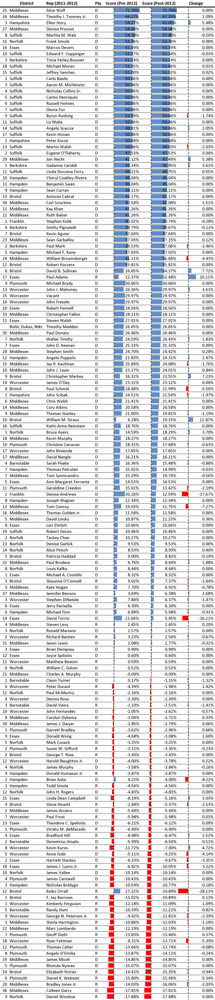
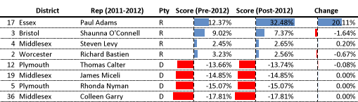
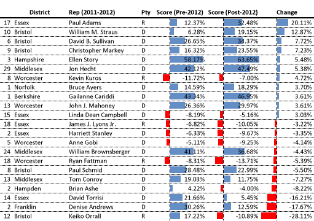

::: {.callout-note appearance="simple"}
Originally published on the [Mass. Numbers Blogger site](https://massnumbers.blogspot.com/2012/11/a-partisan-ranking-of-massachusetts.html) on 2012-11-18.
:::

### Rankings, challenging districts, and redistricting shifts

While the success of a legislative candidate has a great deal to do with the qualifications, ideas, communication skills, and work ethic of the candidate, there are also fundamentals on the ground in terms of the candidate's party and the tendency of the voters in the district to vote for a Democratic or Republican, which can affect the outcome of a legislative race.

In the article [How Democratic or Republican is my town?](../2012-11-15-town-partisan-ranking/index.qmd) I constructed a partisan ranking for each Massachusetts town by averaging the percentage difference between the Democratic and Republican candidates in Governor, Senate and Presidential races from 2006 to 2012. In this article I look at how this partisan ranking breaks down across different geographic regions, namely the Massachusetts House of Representative districts. I will give a partisan ranking to each MA House district based on the partisan score of its municipalities, look at districts that may be challenging for incumbents of a particular party, and also examine the few districts that shifted significantly in partisan lean after 2012 redistricting changes.

It is difficult to directly calculate partisan ranking for House districts using town and city partisan scores because the districts do not fall directly on municipal boundaries. In addition, the Massachusetts Secretary of State does not release precinct-by-precinct results for statewide elections. In order to approximate the partisan ranking for a House district I do a weighted average for the district based on the number of precincts from each municipality in the district. This weighted average approximates a direct calculation using precinct-by-precinct voting numbers in cases where I checked, the exception being in large cities that contain many House districts. The weighted average ends up painting big cities like Boston with a very large brush, showing all districts completely contained within the city as having the same partisan ranking. That is not too concerning for my purposes since the Commonwealth's large cities like Boston are very Democratic. Even so, I may look at the Boston ward and precinct numbers directly in a later article.

Here are the calculated partisan rankings of each House district, both pre- and post-redistricting, sorted by the post-redistricting number. A positive score indicates a Democratic lean corresponding to the average percentage that a statewide Democratic candidate has beaten Republican's in that district, and a negative number indicates a corresponding Republic lean. The representative listed on each line is the person elected in November 2010, serving from January 2011 through January 2013. The most Democratic district by this ranking is the 25th Middlesex District currently served by retiring Rep. Alice Wolf of Cambridge and soon to be represented by Rep-Elect Marjorie Decker. The most Republican district is the 9th Norfolk District currently served by Rep. Dan Winslow of Norfolk.



Here is a [searchable online spreadsheet](https://docs.google.com/spreadsheet/ccc?key=0AkWPTnj-k6-kdHU4dEo1ZzZENHlkQ1dleU9SOU1SNnc) with the same data and an interactive map:

```{r}
#| column: body-outset
#| fig-height: 6

library(tidyverse)
library(sf)
library(tmap)

tmap_mode("view")

ordinal <- function(n) {
    suffix <- case_when(n %% 100 %in% 11:13 ~ "th",
                        n %% 10 == 1 ~ "st",
                        n %% 10 == 2 ~ "nd",
                        n %% 10 == 3 ~ "rd",
                        TRUE ~ "th")
    str_c(n, suffix)
}

ranking <- read_csv("house_district_ranking.csv", show_col_types=FALSE) |>
    transmute(DIST_CODE=DISTRICT,
              District=if_else(is.na(Num), "Barnstable, Dukes and Nantucket",
                               str_c(ordinal(as.integer(Num)), " ", Name)),
              Representative=`Rep (2011-2012)`, Party=Pty,
              pre=parse_number(`Score (Pre-2012)`),
              post=parse_number(`Score (Post-2012)`),
              change=parse_number(Change))

districts <- read_sf("../../_gis/house2012/HOUSE2012_POLY.shp") |>
    st_transform(4326) |>
    select(DIST_CODE) |>
    left_join(ranking, by="DIST_CODE")

tm_shape(districts) +
    tm_polygons(
        fill="post",
        fill.scale=tm_scale_continuous(values=c("#FF4949", "white", "#0F4392"), midpoint=0),
        fill.legend=tm_legend(title="Partisan score, post-2012 (%)"),
        fill_alpha=0.7,
        col_alpha=0.3,
        id="District",
        popup.vars=c("Representative (2011-2012)"="Representative", "Party"="Party",
                     "Score, pre-2012 (%)"="pre", "Score, post-2012 (%)"="post",
                     "Change"="change")) +
    tm_basemap("OpenStreetMap")
```

::: {.callout-note appearance="simple"}
**This map was rebuilt in 2026.** The original interactive map was made with
Google Fusion Tables, which Google shut down on 3 December 2019. This version is
drawn from the searchable spreadsheet linked above, the same data the original
map used, on the 2012-2022 House district boundaries. It reproduces the figures
in this post, including the 2nd Hampden's shift from a 4.22% Democratic lean to
a 4.00% Republican lean.
:::

### Challenging Districts

While it goes without saying that Republicans have greater success in Republican-leaning districts and Democrats have greater success in Democratic-leaning districts, there are Republicans elected in Democratic-leaning districts and vice versa. The next table shows the four most Democratic-leaning districts that were represented by Republicans in the 2011-2012 session, and the four most Republican-leaning districts that were represented by Democrats. Of the four Republican's, only Rep. Shaunna O'Connell will return in 2013. Rep. Paul Adams of Andover lost a bid against Sen. Barry Finegold for the 2nd Essex State Senate seat, and Reps Steven Levy (Marlborough) and Richard Bastien (Gardner) lost to Democratic challengers Rep. Danielle Gregoire and Rep-elect Jonathan Zlotnik. In the Republican-leaning districts on this list, all of the Democratic incumbents, Reps Calter, Miceli, Nyman, and Garry, were able to defeat Republican challengers on November 6.



### Biggest Redistricting Shifts

The Democratic or Republican lean in most House districts did not change dramatically in the 2011 redistricting resulting from the 2010 U. S. Census. This is a testament to the even-handedness of the redistricting committee—it is clear that the committee resisted obvious gerrymandering of districts in favor of either party.

The following table lists the 11 districts that had a Democratic shift of more than 3%, and the 11 districts that had a Republican shift of more than -3%. Of the 22 districts in this table, only two districts changed partisan lean, both changing from leaning Democratic to leaning Republican. The 2nd Hampden District served by Democratic Rep. Brian Ashe of Longmeadow went from a +4.22% Democratic lean to a -4.00% Republican lean—even so, Rep. Ashe was able to defeat Republican challenger Marie Angelides 57% to 43%. The 12th Bristol District served by Republican Rep. Keiko Orrall of Lakeville shifted by over 28% from a +17.22% Democratic lean to a -10.89% Republican lean, most likely a factor in Rep. Orrall's win over Democrat Roger Brunelle in a presidential election year that was favorable to Massachusetts Democrats.



It is clear that the Democratic or Republican lean in a legislative district is only one factor in the success of a particular candidate, but these rankings provide a convenient benchmark to evaluate how strong a candidate needs to be to overcome the partisan lean of a district's voters.
