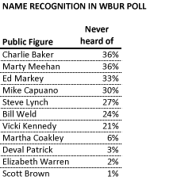
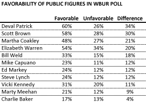
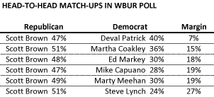
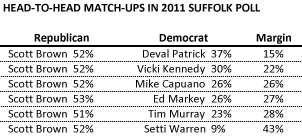

::: {.callout-note appearance="simple"}
Originally published on the [Mass. Numbers Blogger site](https://massnumbers.blogspot.com/2012/12/how-strong-is-scott-browns-position-for.html) on 2012-12-20.
:::

### Brown looks almost as good as he did early in the 2012 contest

All signs point to Massachusetts Senator John Kerry being appointed as the next Secretary of State by President Obama and easily confirmed by the body in which he now sits. This would lead to the appointment of an interim Senator by Governor Deval Patrick, followed by a special election to take place in early summer, 2013. We are in the midst of rampant speculation about who might run for this coveted Senate seat and, more importantly, who has the best chance of winning.

WBUR commissioned [a poll of 500 registered voters](http://www.wbur.org/2012/12/20/wbur-special-senate-election-poll) to gather information about who voters might prefer in a special election. The overall results look very favorable for recently-defeated Senator Scott Brown. He is at the top of the list in terms of name recognition (only 1% of the poll respondents had never heard of him) and got about 50% of the vote in head-to-head match-ups against several possible Democratic nominees.

But what do these results really mean? Does Scott Brown have a lock on the soon-to-be-open Senate seat? While these initial numbers look good, his numbers also looked good in early polls of possible 2012 match-ups—a race that Elizabeth Warren eventually won by 8 points.

### Voters are not familiar with likely Democratic candidates

The poll respondents were asked to say whether they had a favorable or unfavorable opinion of various political figures, including some likely candidates for the open Senate seat. Here is the list of the figures, sorted by lowest name recognition to highest name recognition

It is striking that the least-recognized public figure in the poll was the last Republican nominee for Massachusetts Governor, Charlie Baker, who was defeated by Deval Patrick in 2010. While it does not rule Baker out of a future race for Senate or Governor, it is an inauspicious result for a recent statewide candidate to be unfamiliar to 36% of the electorate.

Baker is followed by former Congressman and current UMass Lowell Chancellor Marty Meehan, and current Congressmen Ed Markey, Mike Capuano, and Steve Lynch. Over 75% of the poll respondents had heard of former Governor Bill Weld, and lawyer and second wife of Senator Ted Kennedy, Vicki Kennedy was recognized by 79% of the respondents.

The real stars of the name recognition contest are Attorney General and former Senate candidate Martha Coakley, Governor Deval Patrick, Senator-Elect Elizabeth Warren, and Senator Scott Brown. All of these public figures are recognized by almost every registered voter. However, Deval Patrick has said he will not run for the Senate seat, and Elizabeth Warren is already a Senator and will not run. It remains to be seen if AG Martha Coakley is willing to tempt another head-to-head match-up with Scott Brown, and whether the Democratic establishment is willing to forgive the embarrassment of their 2010 defeat.

### Patrick and Brown are at the top for favorability

Governor Deval Patrick and Senator Scott Brown have the highest favorability ratings in the poll, both in terms of straight up favorability, and also when comparing the percentage of respondents who rated the figure favorably to those that rated the figure unfavorably.

It is worth noting that Martha Coakley, after taking a beating from the Massachusetts voters (and subsequently from disappointed Democrats) in the special election against Scott Brown, is once again regarded favorably with almost half the respondents viewing her in a favorable light.

We see another bad sign for Charlie Baker with the lowest Favorable-minus-Unfavorable rating, although only 30% of the respondents in a 500 person sample had an opinion.

### Matchups

The poll asked respondents who they would vote for in theoretical match-ups between Scott Brown and possible Democratic candidates. Scott Brown won in all cases with margins ranging from 7% against Deval Patrick to 27% over Steve Lynch. This table shows then sorted from tightest to largest margin.

### How things looked for Scott Brown in April, 2011

Does this mean that Scott Brown is a lock to win the 2013 special election for Senate? Before reading too much into Scott Brown's dominating position over various possible Democratic candidates, it is worth noting how things looked early in the 2012 election cycle before the eventual candidates were know. In April, 2011 Suffolk University did [a survey pitting Scott Brown against various possible Democratic contenders](http://tpmdc.talkingpointsmemo.com/2011/04/poll-sen-scott-brown-trounces-dem-challengers-in-reelection-bid.php) including Deval Patrick, Vicki Kennedy, Mike Capuano, Ed Markey, Lt. Governor Tim Murray, and Newton Mayor Setti Warren.

Scott Brown led every matchup by between 15 and 43 points (compared to the range of 7 to 27 points in the recent WBUR poll), but Brown ended up losing to Elizabeth Warren in a major defeat by 8 points on November 6, 2012.

It is undeniable the Senator Scott Brown is in a strong position for an open Senate seat run in terms of name recognition and favorability, but Senator Brown was in an even strong position in 2011 and ended up losing handily to Senator-Elect Elizabeth Warren. The success or failure of the Democrats in a 2012 special election will hinge on the quality of the selected candidate, and the harnessing of the incredible ground game unleashed by the party and the Warren campaign in 2012.
