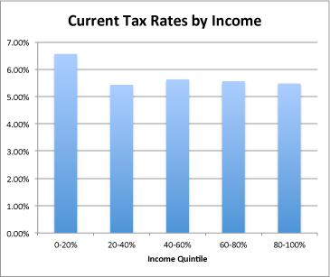
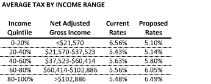
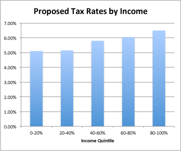
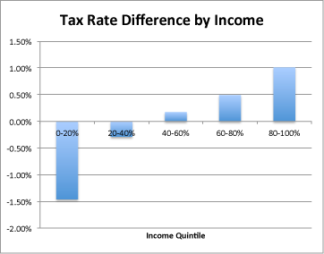

::: {.callout-note appearance="simple"}
Originally published on the [Mass. Numbers Blogger site](https://massnumbers.blogspot.com/2013/01/gov-patricks-tax-proposal-would-mean.html) on 2013-01-20.
:::

## A more progressive structure shifts burden from lowest-income payers

On Wednesday, January 16 Massachusetts Governor Deval Patrick gave his [seventh State of Commonwealth speech](http://www.mass.gov/governor/pressoffice/speeches/0116-state-of-the-commonwealth.html). In his speech he called for increased investment in Massachusetts education, infrastructure, and transportation—a welcome message given the increasing pressures on public schools and deteriorating roads, bridges, and a struggling transportation system. In order to pay for these additional investments, Governor Patrick proposed tax system changes that would raise the state income tax from 5.25% to 6.25%, increase the personal income tax exemption to minimize the effect on lower income taxpayers, and lower the state sales tax from 6.25% to 4.5%.

Why did Governor Patrick propose lowering one tax and raising another tax to raise additional revenue, and how would these tax changes affect taxpayers at various income levels?

The Governor's changes were intended to move from the current regressive tax system—which has the lowest-income residents paying a higher percentage of their income in state taxes—to a more progressive system where higher-income taxpayer are asked to pay slightly more. If the state legislature passes the Governor's proposal, the lowest-income taxpayers will pay less, middle-income taxpayers will pay about the same, and high-income taxpayers will pay slightly more, when measured as a percentage of total income.

### Massachusetts has a regressive tax system

Massachusetts currently has a regressive tax system where lower-income taxpayers pay a higher percentage of their income in total taxes when compared with their higher-income neighbors. This is a result of the 6.25% sales tax, paid equally by people of all incomes when purchasing goods, combined with a uniform income tax rate of 5.25% for all income levels, with a small amount of relief at the low end in the form of a personal exemption.

The current combination of sales and income tax rates leads to the following overall breakdown for tax burden, grouped by quintiles (five steps with breaks at 20%, 40%, 60%, 80%).

Surprisingly, the lowest income taxpayers with incomes of less than $21,570 end up paying the largest percentage of their income in combined taxes at 6.56%. Those in the 20-40% ($21,570-$37,523) and the highest 80-100% (>$102,886) quintiles pay the least at 5.43% and 5.48%. The 40-60% ($37,523-$60,414) and 60-80% ($60,414-$102,886) quintiles have combined rates of 5.63% and 5.56% of their incomes. This is by no means a fair way of allocating tax burden across income levels.

The fairness argument for progressive taxation is strong, boiling down to the fact that 5% of a $30,000 income ($1,500) is much more useful to a low-income family, than 5% of a $1 million income ($50,000) helps a very wealth family. The fancy economic term for this is the *decreasing marginal utility of income*. Simply stated, placing a larger tax burden on a poor person has a much more negative effect on happiness and well-being.

One solution to the regressive tax structure would be a true progressive income tax with graduated tax rates for different income levels, as exist for the federal income tax. Unfortunately, the Massachusetts Constitution does not allow for a truly progressive income tax.

### Gov. Patrick's proposed changes would make MA taxes more progressive

The tax changes proposed by Governor Patrick—a lowering of the sales tax rate from 6.25% to 4.5% and a raising of the income tax rate from 5.25% to 6.25% with a higher personal exemption—would bring about a more progressive taxation system for the Commonwealth, with lower-income families paying a slightly smaller overall tax burden when compared to higher-income families. This chart shows the comparison between current rates and proposed rates, by income level.

These new rates result in a *slightly* progressive overall state tax rate—definitely an improvement.

While this moves Massachusetts towards a more progressive taxation system, the actual difference in percentage of income paid in taxes are small, with the lowest-income taxpayers getting a 1.5 point decrease and the highest-income taxpayers getting a 1 point increase. Middle-income taxpayers rates stay almost exactly the same, with a 17 hundredths of a point difference.

Governor Patrick's tax proposal is an incremental and well-thought-out proposal to raise revenue for critical priorities like education and infrastructure, while also increasing the progressiveness and fairness of our tax system and putting a slightly higher burden on those that can most afford it. Most taxpayers will pay the same or lower state taxes if Governor Patrick's proposal were to become law.
