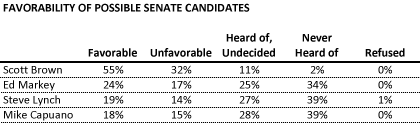
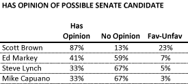

::: {.callout-note appearance="simple"}
Originally published on the [Mass. Numbers Blogger site](https://massnumbers.blogspot.com/2013/01/poll-analysis-most-voters-still.html) on 2013-01-28.
:::

The press release for last week's MassINC poll of the upcoming special election for Senate touted strong performance by possible candidate Scott Brown versus some Democratic contenders. While Brown's position may or may not be strong, the name recognition numbers of Democrats Ed Markey and Steve Lynch are still too low to base that conclusion on these particular polling results.

President Barack Obama has nominated John Kerry to replace Hillary Clinton as United States Secretary of State, and his approval is all but assured. Governor Deval Patrick will appoint a short-term interim replacement and there will be a special election to pick a full-time replacement this summer. U.S. Congressman Ed Markey has declared his intention to run for the Democratic nomination and there is speculation that recently-defeated Republican Senator Scott Brown and Democratic Congressman Steve Lynch may run for the Senate seat.

MassINC Polling has conducted [a second poll of the race](http://www.massincpolling.com/?p=784), testing the performance of these three candidates (as well has Congressman Mike Capuano who has already said that he will not run for the seat). While Scott Brown tests higher than Markey or Lynch, the majority of voters still do not have an opinion of the Democratic congressmen. Based on polling in past races, it is too early to make any conclusions on how these candidates will fare in the special election based on this poll.

Let's first look at the top-line results of the MassInc Poll.

Scott Brown's favorability number of 55% is much higher than any of the other prospective candidates, but it is important to consider those numbers in the context of whether the poll respondent knows the candidate well enough to form an opinion. If we consider the favorable/unfavorable numbers together as indicating enough knowledge to form an opinion, we see that significantly less than half of the poll respondents have any opinion at all about the non-Brown candidates.

Markey has a great deal of work to do in order to successfully portray a positive picture of his policy positions and accomplishments, but he has a relatively blank canvas to paint on, given that 6 out of 10 voters have yet to form any opinion about him—for Lynch, it is two-thirds.

### Do Democratic voters want a primary?

Another conclusion of the MassINC poll was that over 70% of respondents that would vote in a Democratic primary would prefer a contested primary, but it is worth looking at the exact wording of the question:

*Many leaders within the Democratic Party have given their support to Ed Markey for the open Senate seat, and discouraged other potential Democratic candidates from running. In your view, should Democratic Party leaders all get behind Ed Markey and encourage other Democratic candidates not to run? Or should voters be able to choose from among several candidates in a Democratic party primary?*

It is striking that only 71% of respondents indicated a preference for a primary given the leading nature of this question (*do you want the nominee to be picked democratically, or by party insiders in a smoke-filled room?). *This is more an indication that Markey and the party are vulnerable to an accusation that they are trying to discourage other candidates from running, rather than an actual desire for a primary.

It is important for Democrats who are throwing their weight behind Markey to make it clear that they are choosing the candidate they feel is the best person for the job, rather than trying to discourage competition. It would also be a good idea for Democrats to celebrate the democratic process if others decide to enter the race, counting on the best candidate to win.
