::: {.callout-note appearance="simple"}
Originally published on the [Mass. Numbers Blogger site](https://massnumbers.blogspot.com/2013/01/from-capuanos-7th-to-tierneys-6th.html) on 2013-01-31.
:::

While all nine Massachusetts Congressional districts were won by Democrats in November, the districts are by no means equally liberal. I will break down and quantify the Democratic-lean of the districts from Mike Capuano's incredibly blue Boston-based 7th District, to John Tierney's barely Democratic North Shore-based 6th District, and the finer gradations of districts in between. The districts held by Ed Markey and Steve Lynch are within the liberal end of the Democratic-leaning bunch, and are fairly safe bets to stay in the Democratic column if one of them is elected as the new U.S. Senator from Massachusetts.

Massachusetts is considered one of the bluest states in the nation, with a Democratic Governor, two Democratic U.S. Senators, nine Democratic U.S. Representatives, and strong Democratic majorities in the State Senate and House. The Commonwealth went through a redistricting process in 2011 based on the 2010 U.S. Census and one of the results of the redistricting was losing a Congressional district, going from ten districts to nine. While Democrats won all nine of the newly-drawn districts in November, there was little evidence of political gerrymandering or incumbent protection and the districts range politically from very, very blue, to barely blue at all. Incumbent Barney Frank chose not to run because of major changes to his district, and incumbent John Tierney retained his seat by the slimmest of margins.

Here is a ranking of the nine districts based on weighted averages of the partisan ratings of the municipalities as shown in the article [How Democratic or Republican is my town?](../2012-11-15-town-partisan-ranking/index.qmd)—these top-level results are sorted from most-Democratic, to least-Democratic.

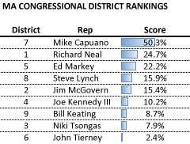

The way to interpret the score is as the average difference between the percentage won by the Democratic and Republican candidate in statewide races from 2006-2010. Democrats beat Republicans by an average of 50% in Capuano's 7th District, compared to a very small 2.4% advantage for Democrats in Tierney's 6th District. (Note: when I refer to a district as "Capuano's", "Tierney's", etc., I am simply stating which person currently holds the seat, rather than implying that the particular Representative has any special ownership or privilege to the seat.)

Capuano's 7th District is by far the most Democratic, with twice the score of the next-highest seat. Richard Neal's Western 1st District and Ed Markey's MetroWest 5th District both have scores of over 20%. The Western/Central/Worcester 2nd District of Jim McGovern and the southern-facing 8th District of Steve Lynch hover around a 16% Democratic advantage. Bill Keating's 9th District on the Cape, Joe Kennedy's southern suburban 4th District, and Niki Tsongas's Merrimack Valley-based 3rd District scores range from 8 to 10%. John Tierney's 6th District on the North Shore is very close to an even Democratic/Republican split with a score of 2.4%.

Here is a map of the districts, with darker blue indicating strong Democratic lean.

### Map of MA Congressional District partisan lean

```{r}
#| column: body-outset
#| fig-height: 6

library(tidyverse)
library(sf)
library(tmap)

tmap_mode("view")

# District score: each municipality's partisan score weighted by the number
# of its precincts in the district, as described above.
district_scores <- read_csv("district_town_scores.csv", show_col_types=FALSE) |>
    mutate(score=parse_number(Score)) |>
    group_by(DIST_NUM=District) |>
    summarize(score=round(weighted.mean(score, Precincts), 1),
              municipalities=n())

districts <- read_sf("ma_congress_2012.geojson") |>
    left_join(district_scores, by="DIST_NUM") |>
    mutate(District=str_c(DIST_NUM, c("st", "nd", "rd", rep("th", 6))[DIST_NUM],
                          " Congressional District"))

tm_shape(districts) +
    tm_polygons(
        fill="score",
        fill.scale=tm_scale_continuous(values=c("white", "#0F4392"), limits=c(0, 55)),
        fill.legend=tm_legend(title="Partisan score (%)"),
        fill_alpha=0.7,
        id="District",
        popup.vars=c("Partisan score (%)"="score", "Municipalities"="municipalities")) +
    tm_basemap("OpenStreetMap")
```

::: {.callout-note appearance="simple"}
**This map was rebuilt in 2026.** The original interactive map was made with
Google Fusion Tables, which Google shut down on 3 December 2019. This version
computes each district's score from the Massachusetts Congressional District
Towns spreadsheet linked below, reproducing the figures above, and draws it on
the 2013-2022 district boundaries.
:::

From a geographic point of view, the most Democratic-leaning districts are in the Boston metropolitan area, and in the western 1st Congressional District of Richard Neal with a swath of moderation from the Cape up through the outer suburbs, to the North Shore. Here is a look at the partisan lean of each the municipalities in each district individually.

### 7th Congressional District (Capuano)

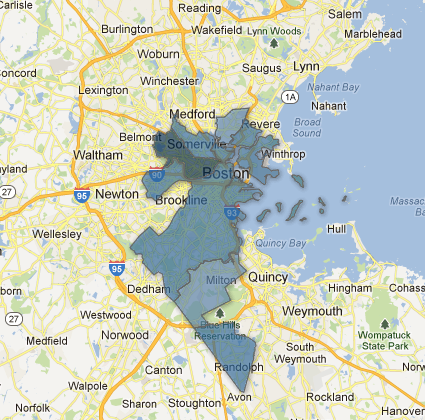

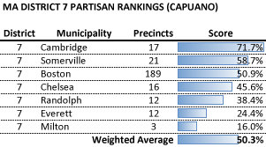

The 7th Congressional District currently held by Rep. Mike Capuano is overwhelmed by its 189 precinct share of Boston, while getting additional Democratic lean from Cambridge and Somerville. The least Democratic town in the district is Milton, where the average Democrat still wins by 16 points. The weighted average ends up being a pretty astounding 50.3% Democratic lean.

### 1st Congressional District (Neal)

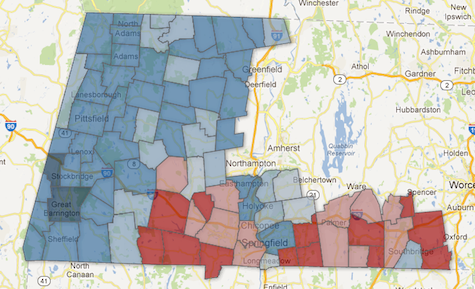

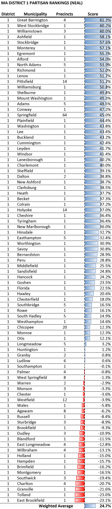

The 1st Congressional District currently represented by Stephen Neal comprises much of Western Massachusetts and has the largest count of municipalities with 86 cities and towns. While there are plenty of Republican-leaning towns in the southern part of the district, these are far outweighed by the Democratic strongholds including cities like Pittsfield and Springfield, and towns like Williamstown, North Adams, and Great Barrington. The weighted average is 24.7%, less than half the Democratic lean of Capuano's 7th District.

### 5th Congressional District (Markey)

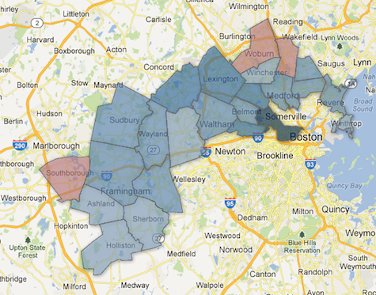

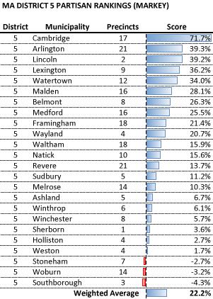

The 5th Congressional District represented by Senate candidate Ed Markey is slightly less Democratic than Neal's 1st District, but most of the municipalities are less Democratic, with every municipality other than Cambridge below a 40% score. There are even three slightly Republican-leaning towns in Stoneham, Woburn, and Southborough. The weighted average score for the district is 22.2%.

### 8th Congressional District (Lynch)

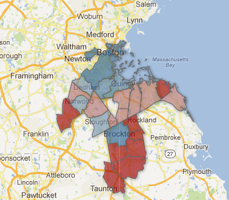

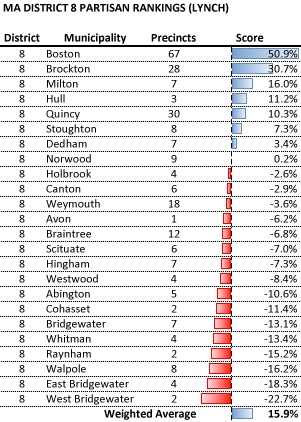

While the 8th Congressional District of Steve Lynch has 67 precincts of Boston and all of working-class Democratic Brockton, the majority of the municipalities are Republican-leaning. That being said, the additional precincts in the Democratic areas give Lynch's district a weighted average of 15.9%.

### 2nd Congressional District (McGovern)

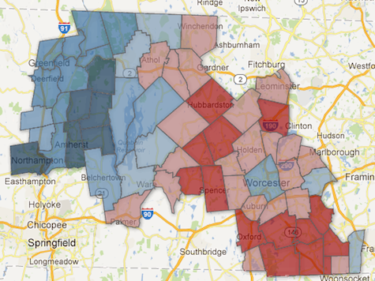

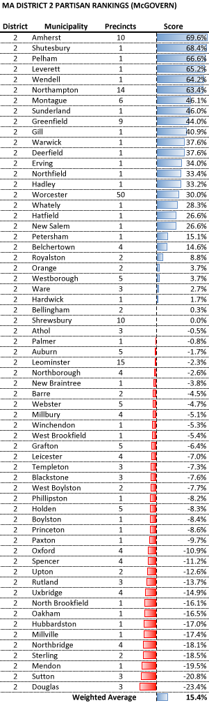

The 2nd Congressional District of Jim McGovern extends far enough west to include many very Democratic communities like Amherst and North Adams. It also includes very Republican-leaning Central Massachusetts towns like Sutton and Douglas in the ex-urban areas around Worcester. This balance is tilted toward the Democratic side with a weighted average score of 15.4%—very close to Lynch's 8th District.

### 4th Congressional District (Kennedy)

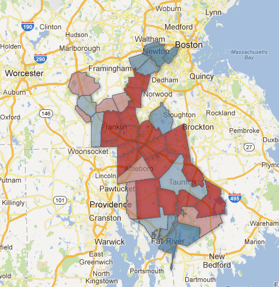

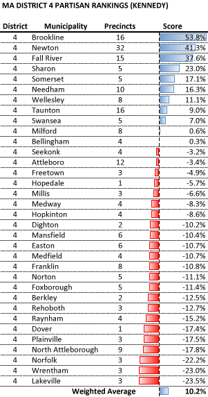

The 4th Congressional District of first-year Representative Joe Kennedy is also a bit bi-polar with very Democratic Boston suburbs like Brookline and Newton, working-class Fall River and Taunton, and the very rich Wellesley. On the Republican-leaning side there are Norfolk, Wrentham, and Lakeville. The balance is a bit more Republican with a weighted average of 10.2%.

### 9th Congressional District (Keating)

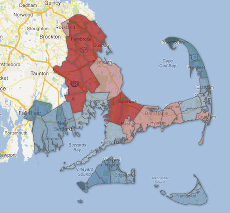

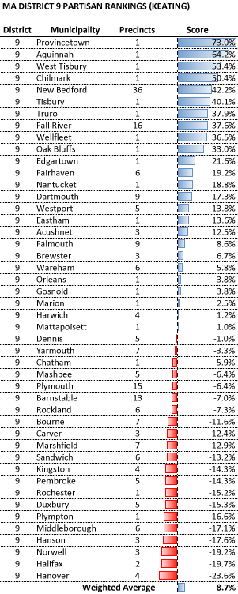

The 9th Congressional District of Bill Keating has the most Democratic town in the Commonwealth in Provincetown (a 73% score!) and the very Democratic towns of Martha's Vineyard. As the district moves up the Cape, the towns gets more Republican. The weighted average puts the district's score at 8.7%.

### 3rd Congressional District (Tsongas)

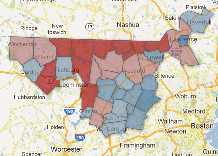

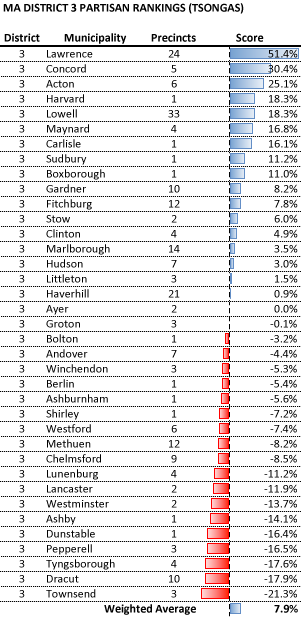

The 3rd Congressional District of Niki Tsongas ranges from Lawrence and Lowell in the Merrimack Valley, down through the affluent suburbs of Concord, Acton and Harvard, up through the very Republican towns of Pepperell, Tyngsborough, Dracut, and Townsend on the New Hampshire border. The weighted average score is the second-lowest at 7.9%.

### 6th Congressional District (Tierney)

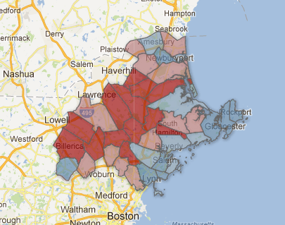

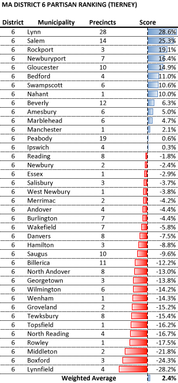

Incumbent John Tierney won the election for the 6th Congressional District over a strong challenge by Republican Richard Tisei by a tiny margin of 4,330 votes. That is not surprising given very small Democratic lean of the district with a score of 2.4%. The most Democratic towns in the District are on Lynn, Salem, and Rockport. The most Republican-leaning towns in the district are also the most Republican-leaning towns in the Commonwealth, Boxford and Lynnfield. The 6th Congressional District will likely face the toughest Republican challenges to full-Democratic representation in the Massachusetts Delegation.

- [Massachusetts Congressional District Towns](https://docs.google.com/spreadsheet/ccc?key=0AkWPTnj-k6-kdEE5SjRIcEE5Y3cycUMybDF1WlRWbXc)

- Map of Massachusetts Congressional District Partisan Rankings

- [Spreadsheet of vote totals for each town](https://docs.google.com/spreadsheet/ccc?key=0AkWPTnj-k6-kdG5Xci1CWmQ3bDV3TFdlRXk5eVRmcmc&usp=sharing)

::: {.callout-note appearance="simple"}
The map of district partisan rankings in this list was published with Google
Fusion Tables and is no longer available; the map above is rebuilt.
:::
