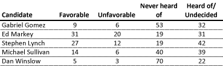
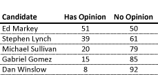
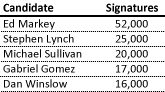

::: {.callout-note appearance="simple"}
Originally published on the [Mass. Numbers Blogger site](https://massnumbers.blogspot.com/2013/03/senate-candidates-still-struggle-for.html) on 2013-03-07.
:::

The special U.S. Senate primary election is a little over 50 days away and a new UMass Lowell/Boston Herald poll shows that Congressman Ed Markey is the only candidate for whom the majority of voters have formed an opinion.

While most commentators are discussing the top-line numbers showing Markey with a 29.5 point lead of 50.0% to 20.5% over Congressman Stephen Lynch, it is again worth noting that voters have not even heard of most the primary candidates.

The candidates that have collected and certified enough signatures to qualify for the April 30th primary are Democrats Markey and Lynch, and Republicans Gabriel Gomez, Michael Sullivan, and Dan Winslow.

The UML poll gives the following results for the favorability/name recognition questions:

**Favorable/Unfavorable**

It is hard not to get captivated by the Favorable/Unfavorable numbers, but it is instructive to combine *Favorable* and *Unfavorable* into a *Has Opinion* category, and combine *Never heard of* and *Heard of/Undecided* into a *No Opinion* category. This give us the following chart, sorted by *Has Opinion*:

**Opinion/No Opinion**

Markey has crept up to the point that half of the voters in Massachusetts have formed an opinion about him, while all of the other candidates are well below 50 percent. Only 40 percent of voters have formed an opinion of Lynch, and the highest percentage for a Republican is 20 percent for Michael Sullivan. Only 15 percent of voters have an opinion of financial businessperson Gabriel Gomez, and a minuscule 8 percent of Massachusetts voters have an opinion of State Representative Dan Winslow.

What does this mean? It means that we are too early to come to definitive conclusions about who will win the primary on April 30th or the general election on June 25th. However, it does give us some idea about which candidates have a longer row to hoe. At this point in the election cycle, the name recognition factor can play a large factor in the willingness of volunteers to get involved and in donors being willing to make donations. While ideology is definitely at play when choosing a candidate to support, viability can be critical factor as well.

The candidates' signature gathering efforts seem to roughly correspond to the polling recognition levels. While reports vary as to the actual number of signatures gathered by each candidate, the popularly reported numbers below follow the same sort order as the UML Opinion/No Opinion numbers:

The fact that Gomez and Winslow primarily used paid signature gathering firms also indicates they have some work to do to generate enthusiasm and volunteer support.

While no candidate has a lock on the Massachusetts Senate primary or general race, Markey has the easier path in the Democratic primary, and the Democrats will have an easier, but not inevitable, path to victory in June.
