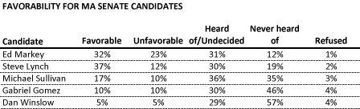
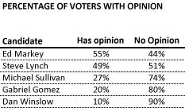
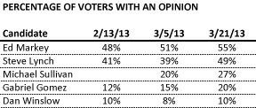
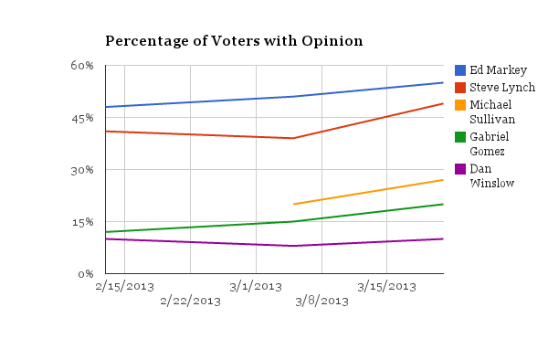

::: {.callout-note appearance="simple"}
Originally published on the [Mass. Numbers Blogger site](https://massnumbers.blogspot.com/2013/03/senate-candidates-desperately.html) on 2013-03-26.
:::

The primary for the Massachusetts Senate Special Election to replace John Kerry is about a month away and only one candidate has enough name recognition to warrant an opinion from the majority of prospective voters.

The [new poll from WBUR and MassINC](http://www.wbur.org/2013/03/26/wbur-poll-massachusetts-senate) shows that each candidate is recognized by slightly more people than earlier this month, but the Democratic candidates are hovering around 50% and the Republican candidates around 20%, in terms of voters that hold an opinion.

The latest numbers from the poll show the following favorability breakdown.

We can also look at at the percentage of voters that hold an opinion, and those that have not yet formed an opinion.

If we compare these opinion numbers to the ones in the [WBUR/MassINC poll of February 11-13](http://www.wbur.org/2013/02/15/senate-poll-markey-lynch), and the [UML poll from March 2-5](http://www.uml.edu/Research/Centers/public-opinion/polls/Special-Senate-Election-2013/default.aspx), we see small increases for all of the candidates except Dan Winslow. Republican Michael Sullivan was not included in the February WBUR/MassINC poll.

Steve Lynch shows the fastest rise this month, but is still below Markey in both having an opinion (55-49%), and in head-to-head voting numbers (35-24%). The bright spot for Lynch is the number of persuadable voters that are left, but it is unlikely that there is enough time, enthusiasm and grass roots support to out-work and out-organize Markey's growing ground grame.

The most disappointing number has got to be for State Representative Dan Winslow who started at 10% of voters with an opinion in February, went slightly down at the beginning of March to 8%, and is only back up to 10% again nearing the end of March. Historically speaking, [it is incredibly hard to win a Senate election without a larger platform than State Representative](../2013-01-03-senate-candidate-qualifications/index.qmd).

It may be that this lack of name recognition will lead to volatile and rapid changes in the final weeks before the primary as [David Bernstein mentions in his recent blog post](http://blog.davidsbernstein.com/2013/03/26/survey-says-who-are-these-people.aspx). It is more likely, however, that trajectories of the candidates will remain the same with comfortable wins by Markey in the primary and general election.
