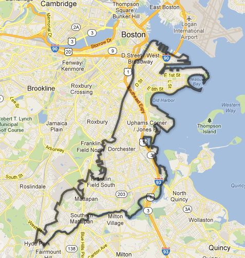
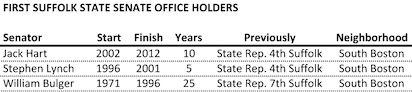
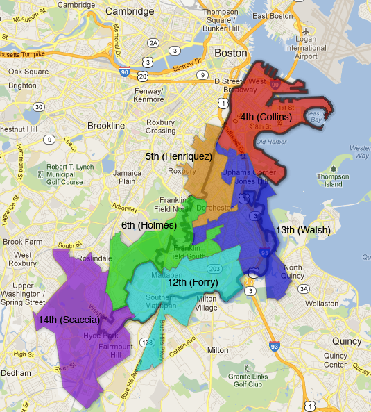
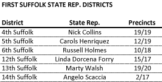
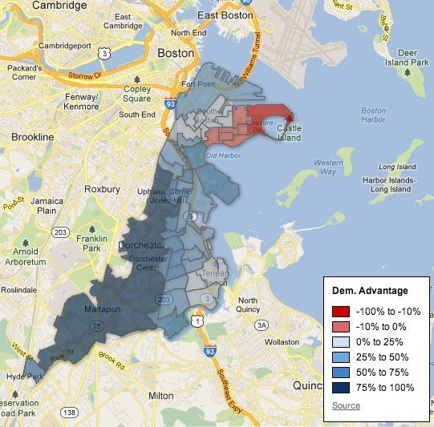
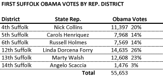

::: {.callout-note appearance="simple"}
Originally published on the [Mass. Numbers Blogger site](https://massnumbers.blogspot.com/2013/04/a-look-at-first-suffolk-state-senate.html) on 2013-04-04.
:::

State Senator Jack Hart's unexpected decision to step down from his First Suffolk Senate seat has lead to a Democratic primary scramble including Fourth Suffolk House District Representative Nick Collins of South Boston, Twelfth Suffolk House District Representative Linda Dorcena Forry of Dorchester, and political newcomer Maureen Dahill of South Boston.

The candidates provide an interesting window into the diverse district, with Collins and Dahill hailing from the more conservative South Boston part of the district, while Forry's district includes parts of the more liberal neighborhoods of Dorchester, Mattapan, and Hyde Park.

I will look at where the Collins and Forry districts sit in relationship to the First Suffolk Senate District boundaries and look to see if there is a natural advantage for any of the candidates.

**The First Suffolk Senate District**

The seahorse-shaped First Suffolk Senate District starts with the well known, tight-knit, and relatively conservative South Boston neighborhood, precedes southward through Dorchester and Mattapan, and finishes with part of Hyde Park, the southernmost neighborhood of Boston.

Senator Jack Hart, a South Boston native, held the First Suffolk seat from 2002 until 2013. He was preceded by current U.S. Representative Stephen Lynch, a South Boston native who held the seat from 1996 to 2001. Lynch was preceded by South Boston native and Senate President William Bulger who held the seat for 25 years from 1971 through 1996.

For the last 40 years the First Suffolk State Senate seat has been held by a former State Representative from South Boston. Does that mean that Maureen Dahill does not have a chance because she is not a State Representative, or Linda Dorcena Forry cannot win because she is not from South Boston?

**Geography**

Let's look at which State Representative districts overlap the First Suffolk Senate district and then look at the recent election results from those districts.

There are 6 State Representative districts that overlap with the First Suffolk Senate District to some degree.

The 4th Suffolk District of Nick Collins is the only district fully contained within the borders of the First Suffolk Senate District. Linda Dorcena Forry's 12th Suffolk District has two precincts that fall outside the First Suffolk boundaries, a possible disadvantage in terms of the number of people that have seen her name on a ballot before. It does not seem, however, to be enough of an advantage to guarantee a South Boston candidate with an automatic win of the First Suffolk Senate District. Let's look at some actual voting numbers to better understand the district.

**Electoral Results**

What is the distribution of Democrats that will vote in the April 30 primary in the district? Is it true that South Boston is much more conservative than Boston as a whole?

Here is a heat map of the First Suffolk Senate District showing the Democratic or Republican strength of each First Suffolk precinct. The darker the blue, the more Democratic, and the darker the red, the more Republican, based on an average of the 2012 Presidential election results for President and Senate.

This map makes it clear that South Boston is a somewhat Republican bastion in a sea of Boston blue. There are six Southie precincts that voted between 1-10% more Republican than Democratic, and the 9th Precinct of Ward 6 at the Pleasure Bay end of South Boston voted 12% more Republican than Democratic in 2012.

The numbers for the rest of the district tell a different story. The eastern parts of Dorchester extending towards Quincy definitely fall in the Democratic camp, but not nearly to the extent of western Dorchester and Mattapan where some precincts only saw a handful of Republican votes in 2012.

We can also calculate the number of Democratic votes for President contributed by each of the State Rep. districts to the overall number for the First Suffolk Senate District.

While one hundred percent of Nick Collins's South Boston 4th Suffolk District is within the senate district, only 20% of the district votes for Obama came from his district, while 26% of them came from Linda Dorcena Forry's 12th Suffolk District. That is somewhat surprising give that not all of Forry's Rep. district is within the senate district. This likely means that Forry is not at a disadvantage to Collins in terms of district overlap.

**Conclusion**

History would seem to indicate that Nick Collins is at a strong advantage in the First Suffolk Senate race—the last three winners of the seat were State Representatives from South Boston. The electoral numbers tell a different story. Only 20% of the Democratic votes from the election are likely to come from South Boston, and the deeply Democratic parts of the district in Dorchester and Mattapan are very likely to support Linda Dorcena Forry who has a more progressive voting record and reputation than Collins.

Maureen Dahill is the wildcard in the race, but it is unlikely that a political newcomer can gear up fast enough to out-organize Collins and Forry. Primary elections, especially special primary elections, are all about voter contact and ground game, and experience and name recognition make a big difference.

South Boston has had an outsized influence on Boston and Massachusetts politics. Candidates like Billy Bulger and Steve Lynch took their working-class stories from Southie to the national stage. It is likely, however, that the continuing move of Boston's voters towards more progressive leaders will lead to a strong showing by Linda Dorcena Forry on April 30.

**Maps and Data Sets**

- Map of First Suffolk Senate District and Rep. Districts

- Map of First Suffolk Sen District Presidential Results

- Map of First Suffolk Presidential Results by House District

::: {.callout-note appearance="simple"}
The maps and data sets in this list were published with Google Fusion Tables,
which Google shut down on 3 December 2019. The links no longer lead anywhere and
no copy of the tables survives; the maps above are the static images from the
original post.
:::
