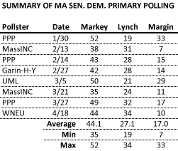
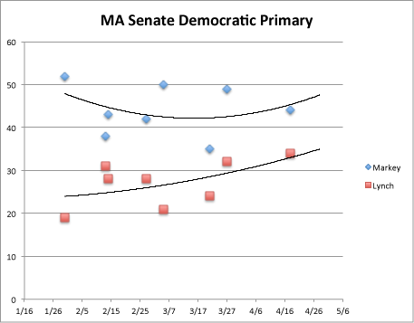
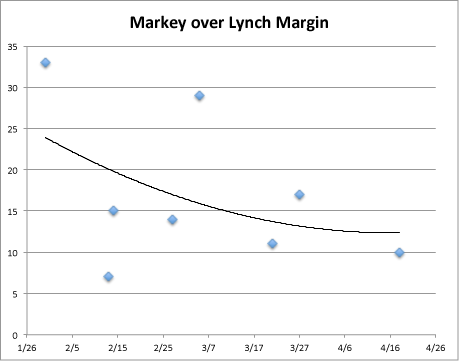

::: {.callout-note appearance="simple"}
Originally published on the [Mass. Numbers Blogger site](https://massnumbers.blogspot.com/2013/04/polling-average-shows-markey-with.html) on 2013-04-22.
:::

The Democratic primary for the Massachusetts U.S. Senate special election is one week away and Congressman Ed Markey has led Congressman Steve Lynch in every poll conducted. While recent polling data may indicate a tightening trend, it is unlikely that Lynch can overcome Markey's consistently strong lead to win next Tuesday.

The [latest poll from Western New England University](http://www1.wne.edu/assets/112/WNE_Polling_-_MA_Senate_(April_2013)_TABLES.pdf) shows Markey with a 10 point lead of 44% to 34%. (As a side note, when respondents to the WNE poll were asked who they *thought* would win the election, regardless of how the respondent would vote, Markey led 38% to Lynch's 15%—[recent research](http://assets.wharton.upenn.edu/~rothscdm/RothschildExpectations.pdf) by economists David Rothschild and Justin Wolfers indicates that this type of expectation question has been more predictive than an intention question, possibly because it extends the reach of the survey to the respondents' group of friends, relatives, and acquaintances.)

While the low turnout numbers for special primaries makes polling for these type of races particularly difficult and error-prone, averaging many polls together greatly increases their sample size and statistical accuracy. Markey's lead is an average of 17 points when looking at *all* polls conducted for the primary match-up. The simple average of each candidate's voter share across the polls shows Markey with 44% and Lynch with a 27% share.

Here is a table with the summary of all public polls surveying the MA Senate Democratic Primary match-up between Markey and Lynch—the polls span late January through mid-April.

While there is a large range of results for each candidate over this time period—from 52-35 for Markey and from 34-19 for Lynch, it is notable that the ranges do not overlap—Markey's lowest polling number of 35 percent beats Lynch's highest polling number of 34 percent.

The polling numbers do not show a completely consistent trend for either candidate, but there seems to be a some weakening and then recovery of Markey's numbers in March, while Lynch's trend has been mostly upward, albeit from a lower starting point.

The following graph shows the point margin of Markey over Lynch for each of the polls. The trend line shows a tightening in the race, but the flattening just above a 10 point lead does not bode well for Lynch.

Given the variability in polling firms, methodology, questions, and sample sizes between each of the polls, it is not clear how confident we can be in each individual poll and the resulting tightening trend. It would not be surprising if the trend were real, which will surely give Lynch backers hope, but Lynch will also need to hope that the trend is happening at a faster rate than currently indicated by the data.

Rather than looking at each polling data point separately, a simple average of all of the polls gives a much larger sample of possible voters and a higher level of confidence in the Markey lead (44% to 27%, leading by 17 points). With the resulting average margin of over ten points, we can have fairly strong confidence that Markey is the favorite to win with only one week to go until the election.

**Polling Data**

- [PPP, 1/29-1/30](http://www.publicpolicypolling.com/pdf/2011/PPP_Release_MA_130.pdf)

- [MassINC/WBUR, 2/11-2/13](http://www.wbur.org/files/2013/02/0215_senate-poll-topline.pdf)

- [PPP/League of Conservation Voters, 2/13-2/14](http://www.scribd.com/doc/126277848/MA-Sen-D-PPP-for-LCV-Feb-2013)

- [Garin-Hart-Yang/NARAL, 2/26-2/27](http://www.lcv.org/elections/ma-primary-poll.pdf)

- [UMass Lowell/Boston Herald, 3/2-3/5](http://www.uml.edu/docs/UML-MA-RV-March-2013-TOPLINE_tcm18-91425.pdf)

- [MassINC/WBUR, 3/19-3/21](http://www.wbur.org/files/2013/03/0325_wbur-poll-topline.pdf)

- [PPP/League of Conservation Voters, 3/26-3/27](http://www.lcv.org/elections/research/april-2-markey-race-polling.pdf)

- [Western New England Univ/MassLive/CBS-3, 4/11-4/18](http://www1.wne.edu/assets/112/WNE_Polling_-_MA_Senate_(April_2013)_TABLES.pdf)
