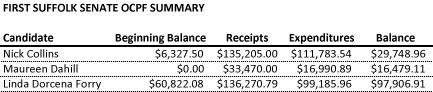
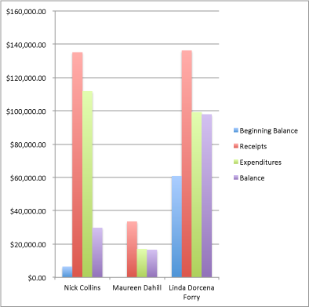
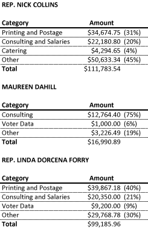

::: {.callout-note appearance="simple"}
Originally published on the [Mass. Numbers Blogger site](https://massnumbers.blogspot.com/2013/04/collins-and-forry-outraise-dahill-in.html) on 2013-04-24.
:::

The Democratic candidates for the [First Suffolk State Senat race](https://massnumbers.blogspot.com/2013/04/a-look-at-first-suffolk-state-senate.html) have filed their [pre-primary campaign finance reports](http://ocpf.cloudapp.net/Filers/SpecialElections) in preparation for the April 30 election to replace State Sen. Jack Hart. State Rep. Nick Collins and State Rep. Linda Dorcena Forry have raised more than four times as much—and spent six times as much—as political newcomer Maureen Dahill. Rep. Forry started and ended the filing period with significantly more money than either of the other candidates, holding close to $100,000 available to use in the final days of the campaign.

Here are the top-level amounts for beginning balance, money raised, money spent, and ending balance.

Rep. Nick Collins began the period with $6,327, raised $135,205, spent $111,783, and ends the period with $29,748.

Rep. Linda Dorcena Forry began the fundraising period with almost ten times as much money as Collins, $60,822, raised slightly more, $136,270, spent slightly less, $99,185, and finished with three times as much, $97,906.

First-time candidate Maureen Dahill started with an empty campaign account, raised $33,470, spent $16,990, and has $16,479 remaining to use before the primary.

**Expenditure Summary**

There isn't anything surprising in the spending summaries of the candidates. Both Collins and Forry spent between 30-40% of their money on printing and postage and around 20% on consulting and salaries. First-time candidate Dahill spent 75% of her money on consulting, which is high from a percentage point of view, but comparable to the other candidates as an absolute amount—Dahill's consulting costs were $12,764.

**Conclusion**

Both Rep. Nick Collins and Rep. Linda Dorcena Forry have met or exceeded expectations in the amount they have raised and spent in their bid for the First Suffolk State Senate seat. In my [overview of the race](https://massnumbers.blogspot.com/2013/04/a-look-at-first-suffolk-state-senate.html) I gave Rep. Forry the edge in this primary race, despite the history of the First Suffolk Senate seat going to a South Boston native State Representative. I believe Forry now has an additional advantage of having significantly more cash on hand going into the last days of the race.
