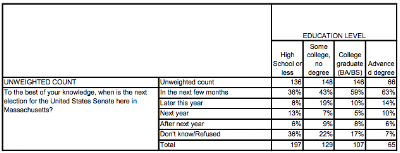
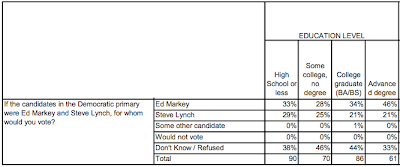

::: {.callout-note appearance="simple"}
Originally published on the [Mass. Numbers Blogger site](https://massnumbers.blogspot.com/2013/04/polls-shows-that-college-educated.html) on 2013-04-29.
:::

[A new poll from MassINC](http://www.massincpolling.com/?p=840) shows that voters with a college or graduate degree are more aware of the imminent Massachusetts special election to replace John Kerry. A [previous poll from MassINC](http://www.wbur.org/files/2013/03/0326_new-wbur-senate-poll-crosstabs.pdf) showed candidate Ed Markey doing significantly better with this same demographic, providing another very positive sign for Markey's chances in tomorrow's primary against Congressman Stephen Lynch.

Massachusetts Secretary of State William Galvin has said that absentee ballot request numbers indicate the likelihood of an extremely low turnout for tomorrow's special primary for U.S. Senate—under- or over-representation of certain demographic groups could make a noticeable difference in the outcome.

A newly released poll by the MassINC polling group shows that about 60% of college and graduate-educated voters are aware that the election for Senate is imminent, while the numbers for those without a college degree are much lower (36% for high school or less, 43% for some college, no degree). This could mean a higher turnout in college and graduate educated voters in Tuesday's election.

The [poll surveying candidate preference released by MassINC on March 26](http://www.wbur.org/2013/03/26/wbur-poll-massachusetts-senate) showed that Congressman Ed Markey significantly outperformed Congressman Stephen Lynch among more educated voters, while the race was much closer among those without a college degree.

While these results need to be taken with a grain of salt given the small sample sizes, they are another positive sign for Markey going into tomorrow's election. If voters with a college or graduate degree show up to the polls in higher numbers, it will most likely be to Congressman Markey's advantage.
