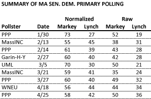
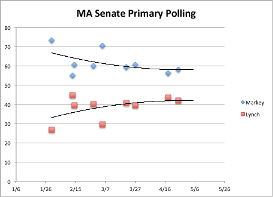

::: {.callout-note appearance="simple"}
Originally published on the [Mass. Numbers Blogger site](https://massnumbers.blogspot.com/2013/05/polling-of-markeylynch-race-converged.html) on 2013-05-01.
:::

Congressman Ed Markey defeated Congressman Stephen Lynch in the Democratic primary on April 30 by 57% to 43%, a 14 point margin. The final poll conducted by Public Policy Polling showed that same margin, and the normalized numbers for all of the polls converged on a 58% to 42% split in Markey's favor, remarkably close to the actual result.

The table and graph below show all of the public polls of the Markey/Lynch match-up from January through April. The normalized numbers were calculated by allocating the undecided voters to each candidate in the same proportion as the decided voters so they add up to 100%, allowing for direct comparison between the polls and the actual result.

The trends show the race evening out at a 58% to 42% split, almost identical to the 57.4% to 42.6% split of the unofficial numbers reported for Markey and Lynch the night of the election. This is pretty impressive, given the lack of public interest in the race and the resulting difficulty of determining who would turn out to vote in the special primary. Special kudos to Public Policy Polling, which pretty much nailed the final result.
