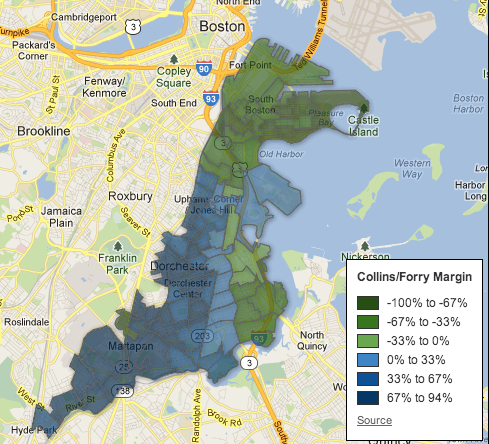

::: {.callout-note appearance="simple"}
Originally published on the [Mass. Numbers Blogger site](https://massnumbers.blogspot.com/2013/05/an-interactive-map-of-first-suffolk.html) on 2013-05-02.
:::

You can click on the map below to access an interactive version with precinct-by-precinct results for the Boston part of the First Suffolk State Senate Democratic primary election between Rep. Nick Collins, Maureen Dahill, and the winner, Rep. Linda Dorcena Forry. The results were obtained from [The Dorchester Reporter](http://www.dotnews.com/P3REP%2018-13web.pdf) and are not official, but give a good feel for the regional strengths of Collins and Forry.

::: {.callout-note appearance="simple"}
The interactive version of this map was built with Google Fusion Tables, which
Google shut down on 3 December 2019. Only the static image survives.
:::

