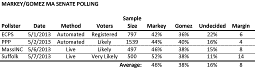
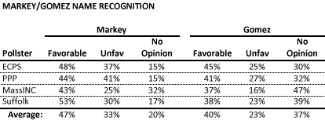

::: {.callout-note appearance="simple"}
Originally published on the [Mass. Numbers Blogger site](https://massnumbers.blogspot.com/2013/05/making-sense-of-markeygomez-poll.html) on 2013-05-09.
:::

There have been four polls conducted to gauge voter sentiment in the Massachusetts U.S. Senate race between Democratic Congressman Ed Markey and Republican financial executive Gabriel Gomez. While all of the polls agree that Markey leads the race, the surveys vary widely as to the size of the lead, with a 4 point spread in the PPP poll at the lower end and a much larger 14 point lead for Markey in the recent Suffolk poll.

How should we make sense of the variable polling results in order to find the current state of the race? Rather than cherry-picking a favorable poll for either candidate, we can get a more statistically valid estimate by averaging the polls together, giving Markey 46% and Gomez 38%, with an 8 point lead for Markey. The averaging process greatly increases the sample size and can smooth out polling inconsistencies. Interestingly, this four poll average matches the results of the MassINC poll.

**What would explain the differences in the polls?**

All of the interviews for the four polls of the Massachusetts U.S. Senate special election were conducted in the single week starting Wednesday, May 1 and ending this past Tuesday, May 7. So what explains the different results between the different surveys?

The biggest difference between the first two polls conducted by the Emerson College Polling Society and Public Policy Polling, and last two polls conducted by MassINC Polling and Suffolk University Political Research Center, is the use of automated polling vs. live interviews. Automated polling systems are not allowed to call cell phones, and while pollsters make an attempt to correct for the different demographics for those people who only have cell phones, automation can lead to different polling outcomes. There is also [evidence to suggest that non-cell-phone polling underestimates Democratic candidates' chances](http://fivethirtyeight.blogs.nytimes.com/2012/09/19/obamas-lead-looks-stronger-in-polls-that-include-cellphones/).

The automated/live distinction cannot be used to explain the difference between the 8 point margin seen by the MassINC and 14 point lead seen by the Suffolk poll, since both surveys used live interviews. While the different results might be because of various methodological difference or sampling error, a strong explanation is the tighter likely voter screen used by the Suffolk poll:

> *Using a split sample of landline and cell phone numbers, the Suffolk poll used a tight screen to filter out voters who weren't certain to vote or who couldn't name when the special general election would be held.*

It is indeed a tight screen when the respondent needs to identify when the election will be held, especially for an off-season special election being held in June. There is evidence from the special primary polling that more engaged voters like these are more likely to support Markey, which may explain some of his larger advantage in the Suffolk poll.

**Name recognition**

An 8 point Markey lead with 47 days until the election does not, by any means, guarantee a Democratic victory on June 25, rather it can give us an idea the gap that Gomez would need to close. The challenge for both candidates will be to define himself on his own terms before being defined by the opposition. Gomez has a bigger risk/reward possibility with a full 37% of the respondents not having an opinion about him.

As you might expect, Markey has higher favorables and unfavorables as a more mainstream candidate. Strong advantages for Markey are the great organizational capabilities of the Massachusetts Democratic party and [policy positions that closely match those of the Massachusetts electorate](http://fivethirtyeight.blogs.nytimes.com/2013/05/06/does-gomez-have-a-real-chance-in-massachusetts/).

While it is interesting to look at the differences between the four senate polls, we are likely to be better served by averaging the results together, giving a more robust view of the state of race to replace John Kerry. The result shows Congressman Markey in a strong position with 47 days to go.

**Survey Details**

- [Emerson College Polling Society survey](http://emersoncollegepollingsociety.com/ECPS_MAUSS_Results_5.1.pdf)

- [Public Pollicy Polling survey](http://www.publicpolicypolling.com/main/2013/05/markey-starts-general-with-4-point-lead.html)

- [MassINC/WBUR survey](http://www.wbur.org/2013/05/09/markey-gomez-senate-poll)

- [Suffolk University Political Research Center/WHDH survey](http://www.suffolk.edu/academics/10732.php)
