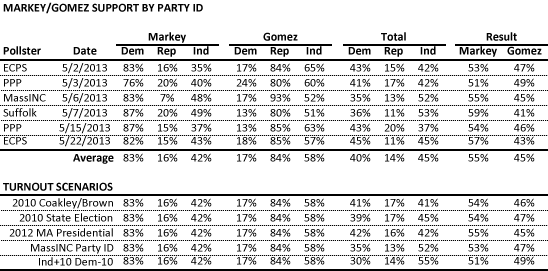
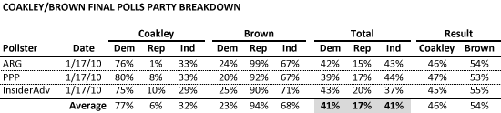

::: {.callout-note appearance="simple"}
Originally published on the [Mass. Numbers Blogger site](https://massnumbers.blogspot.com/2013/05/a-large-independent-voter-turnout-is.html) on 2013-05-28.
:::

Some [recent news coverage](http://boston.cbslocal.com/2013/05/26/keller-large-senate-race-tim-murrays-political-future/) on the topic of the Massachusetts Senate special election seems to imply that a large turnout of independent voters and a low turnout for Democrats would lead to a Gabriel Gomez victory on June 25. A detailed look at the party ID breakdown from all of the Markey/Gomez polls shows that given the candidates' current levels of support, even an unprecedented turnout of independent voters at the expense of Democrats would not lead to a Gomez win.

This table shows the party ID breakdown for all of the public polls that have been conducted for the race between Ed Markey and Gabriel Gomez to represent Massachusetts in the U.S. Senate. While there is similarity across the polls, we get a more statistically relevant result by averaging the polls together. Both of the candidates achieves roughly the same percentage of support from his own party—Markey with 83% of Democrats and Gomez with 84% of Republicans—while Gomez holds a significant 16 point advantage over Markey with independent voters, 58% to 42%.

Each one of the polls also provides its own take on the expected party breakdown of the likely voting electorate. The overall estimate of turnout obtained by averaging the party ID numbers of all six polls give us a 40% Democratic, 14% Republican, and 45% Independent electorate. In this scenario, Markey wins by 10 points, 55% to 45%.

But what would the results be if the party ID breakdown of the electorate on June 25 was different? The bottom part of the table shows a variety of scenarios, including an estimated party breakdown of the Coakley/Brown race (based on late polling), and the 2010 State Election and 2012 Presidential elections (based on exit polls). None of those scenarios puts Gomez closer than 7 points to Markey.

We can also consider the most Gomez-favorable of the party ID breakdowns from the six Markey/Gomez polls—35%-13%-52% in the MassINC poll—which still puts Markey up 6 points. The most extreme scenario is the last where I take the original 40%-14%-45% breakdown predicted by the polls and take 10% of the vote away from Democratic voters and put all 10% with the Independents, giving a 30%-14%-55% split. This most extreme and unlikely of the Independent voter expectations still leaves Gomez 2 points behind Markey at 51% to 49%. It seems that Gomez cannot guarantee a win by shifting the electorate from less Democratic to more Independent.

So how did Scott Brown win the 2010 special election with a generic looking turnout of 41% Democrats, 17% Republicans, and 41% Independents?

The final polls before the January 19, 2010 election suggest that Scott Brown was able to win by obtaining the support of 94% of Republicans, by chipping into the Democratic base with the support of 23% of Democrats, and by dominating among Independents with an amazing 36 point advantage among unenrolled voters.

The history from the 2010 Scott Brown win combined with current polling suggests that Gabriel Gomez is unlikely to win the June 25 special election by simply increasing the turnout of independent voters—instead, he would need to fundamentally shift his level of support with the voters of all three groups. Fundamental shifts in the preferences of the voters, while possible given the upcoming debates and likely ad blitz, are becoming less and less likely with only four weeks until the election.
