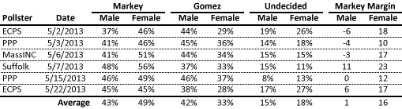
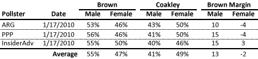

::: {.callout-note appearance="simple"}
Originally published on the [Mass. Numbers Blogger site](https://massnumbers.blogspot.com/2013/06/gomez-will-have-hard-time-overcoming.html) on 2013-06-04.
:::

There have been six public polls of the Massachusetts Senate special election between Congressman Ed Markey and financier Gabriel Gomez, and an averaging of the polls shows Markey with a one point lead among men and a whopping 16 point lead among women. Markey holds positions on women's reproductive health and gun control issues that are more popular with the majority of Massachusetts women than those held by Gomez, making it unlikely that Markey will relinquish that lead.

A [recent New York Times article](http://thecaucus.blogs.nytimes.com/2013/05/31/scramble-for-female-votes-in-mass-senate-race/) detailed Markey's advantage with women and his efforts to solidify and increase his lead among Democratic and Independent women by emphasizing Gomez's unpopular positions on women's health issues and assault weapons. It is clear from the polling of the race that Gomez cannot win without moving his margin with men into the positive double-digits and significantly cutting into Markey's advantage with women, an unlikely scenario given Gomez's stances.

Over the time period of the six polls, Markey has moved from a small disadvantage with men in the first three polls, to a small advantage. He has held a significant double-digit lead with women in every single poll of the race.

Martha Coakley, the Democrat vying against Scott Brown in the 2010 special senate election, also had an advantage among women, according to the last several polls of the race. However, her advantage was about two points, while Brown held a large double-digit 13 point lead over Coakley with men. There were no exit polls of the January 19, 2010 vote.

Gabriel Gomez would need to come close to these sorts of margins to stand a chance on June 25, but the numbers seem to be moving in the opposite direction. Ed Markey's margin with women is solid in the double-digits, and his standing with men has improved, not worsened. Gomez would most likely need a game changer to pull out a win, while Markey has the easier task of making sure likely women voters understand Gomez's positions on the issues.
