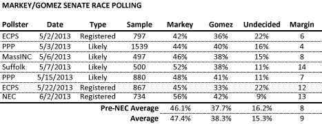
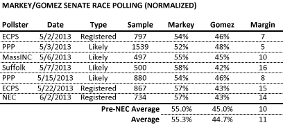
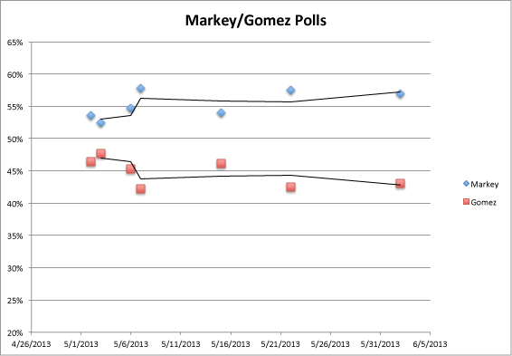
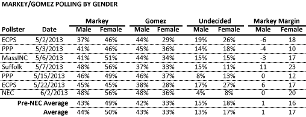
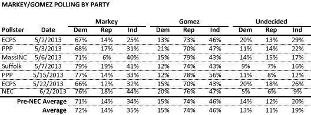

::: {.callout-note appearance="simple"}
Originally published on the [Mass. Numbers Blogger site](https://massnumbers.blogspot.com/2013/06/latest-markeygomez-poll-is-more-of-same.html) on 2013-06-05.
:::

Yesterday, New England College released [another poll of the Ed Markey/Gabriel Gomez special senate election race](http://www.nec.edu/news/markey-holds-solid-lead-over-gomez-in-massachusetts-senate-race) and it does little to change the evidence that Congressman Markey has a sizable lead. The party and gender breakdowns from the NEC poll also align well with previous surveys of the race. Financier Gabriel Gomez is probably hoping for a game changing performance in the upcoming debates, but time is running out and all signs point towards a Markey win on June 25.

Averaging the polls together evens out inconsistencies in polling methods and gives us a much larger sample of voters. The average is largely unchanged by the poll, although the number of undecided voters in the NEC poll is smaller than all of the previous polls, most likely because of the polling question and methodology. The Markey advantage continues to hover around 10 points.

We can normalize the polls to get a better feel for what an actual election result might be like by choosing a method to divide up the undecided voters between the two candidates. I have chosen to divide them up equally. Normalizing the polls also gives us some more consistency between the polls. We again end up with about a 10-point lead for Markey.

The new poll is also consistent with our averages in terms of Markey's margin among men and women. The NEC poll shows Markey even with men (the average is Markey +1) and has Markey +20 with women (our average was +16). As [I wrote in a previous post](../2013-06-04-markey-lead-women-voters/index.qmd), Gomez will have to completely change these margins in order to have a chance on June 25.

The NEC poll is also reasonably consistent with the averages in terms of party breakdown. The higher percentages for both Markey and Gomez in each category primarily come from the undecided percentages, rather than cutting into each other's vote share. [I wrote in a previous post](../2013-05-28-independent-turnout-gomez-markey/index.qmd) that Gomez cannot win by turning out more Independent voters, but rather needs to increase his margins with both Democrats and Independents to stand a chance.

The latest poll brings more of the same with a solidifying lead for Ed Markey that will be very hard for Gabriel Gomez to overcome in the short time before the June 25 special election.
