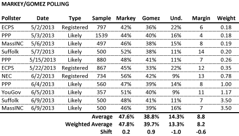
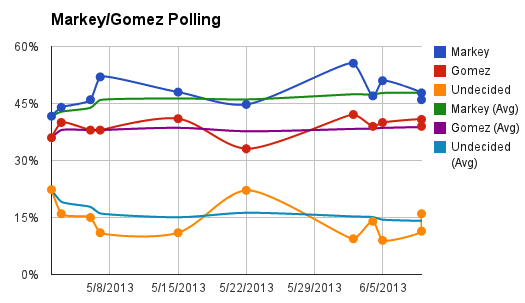

::: {.callout-note appearance="simple"}
Originally published on the [Mass. Numbers Blogger site](https://massnumbers.blogspot.com/2013/06/latest-markeygomez-polls-show-very.html) on 2013-06-11.
:::

The latest polls from [Suffolk University](http://www.suffolk.edu/news/17110.php#.UbcecPbF1tI) and [WBUR/MassINC](http://www.wbur.org/2013/06/11/wbur-senate-poll-2) of the Massachusetts special election race between Ed Markey and Gabriel Gomez provide some evidence of a tightening race. A comparison between a simple average of all of the polls, with a weighted average giving stronger weighting to the most recent polls, shows Markey moving from about a 9 point lead over Gomez, to an 8 point lead. However, this is hardly good news for Gomez as candidates rarely overcome an 8 point deficit with two weeks until an election.

If you have been following the [Mass. Numbers Markey/Gomez polling average page](http://massnumbers.blogspot.com/p/ed-markeygabriel-gomez-massachusetts.html), you have seen that there have been very few surprises as new polling results are released.

In addition to calculating the simple average of the polls, I have also given weighted average, based on the number of days since the last day the poll was conducted. This weighted average shifts the margin from about 9 points to about 8 points. While this does indicate a slight tightening of the race, the polling has been remarkably stable, with all of the polls moving very close above and below the average.

The fact that Congressman Markey continues to hang close to even with men, and to be winning women by about 17 points, combined with Gomez's inability to increase his margin with Independent and Unenrolled voters, means that a Gomez win continues to be a very, very long shot.
