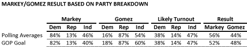

::: {.callout-note appearance="simple"}
Originally published on the [Mass. Numbers Blogger site](https://massnumbers.blogspot.com/2013/06/a-gomez-win-over-markey-very-unlikely.html) on 2013-06-15.
:::

[An article written by Alexandra Joffe in The Hill congressional newspaper](http://thehill.com/blogs/ballot-box/senate-races/305761-gomez-sees-narrow-path-to-victory-in-final-weeks-of-campaign) reports that the Republican Party sees a narrow path to victory for Gabriel Gomez against Ed Markey in the Massachusetts special election to replace John Kerry. However, the numbers don't add up—a Gomez win is very unlikely, even if he achieves the GOP targets described in the article.

The [current aggregated polling averages](http://massnumbers.blogspot.com/p/ed-markeygabriel-gomez-massachusetts.html) for the Markey/Gomez race predict that Gabriel Gomez will win 16% of the Democratic vote, 87% of the Republican vote, and 54% of the Independent/Unenrolled vote as indicated in the table below. Combined with a likely turnout (also based on the polling averages) of 38%/14%/47% for D/R/I puts Gomez with a likely result of 44% of the vote on June 25.

The Joffe article says "Republicans familiar with the race say they’re aiming to win 55-60 percent of independents and 15-18 percent of Democrats to take the seat."

Let's suppose that Gabriel Gomez hits the high end of those targets, winning 18% of the Democratic vote and 60% of the Independent vote, giving Markey 82% of Democrats and 40% of Independents. These Democratic and Independent margins would still only multiply out to 48% of the final vote for Gomez and a winning 52% of the vote for Markey.

However, the polling has been remarkably consistent throughout the race, and it is more likely that the Gomez will win Independents by around 10 points. There is very little time for Gomez to make up his large gaps with Independent women, and Markey has a very high probability of winning the special election on June 25.
