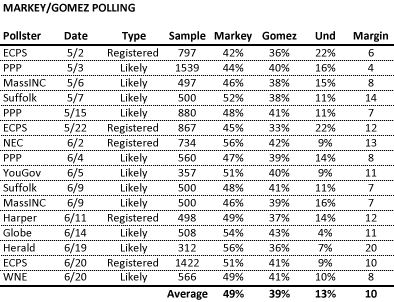
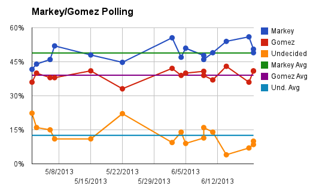
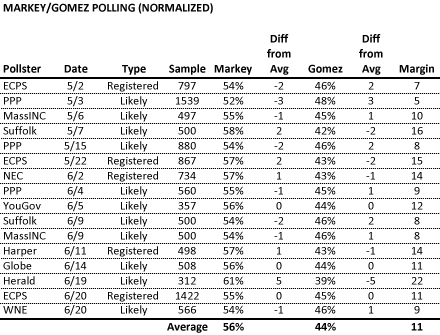
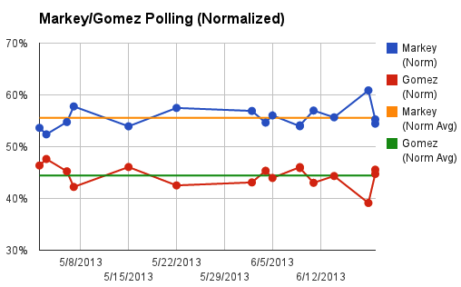
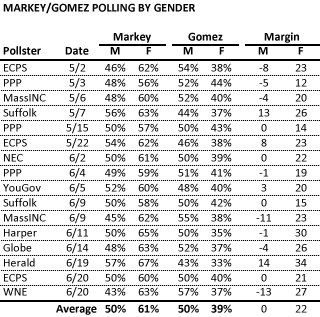
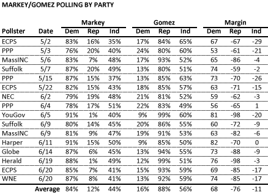

::: {.callout-note appearance="simple"}
Originally published on the [Mass. Numbers Blogger site](https://massnumbers.blogspot.com/2013/06/a-comprehensive-pre-election-overview.html) on 2013-06-24.
:::

There have been 16 independent polls of the match-up to replace John Kerry in U.S. Senate between Congressman Ed Markey and financier Gabriel Gomez spanning the beginning of May through June 20th. Markey has led every poll and average of all polls gives Markey 49% to Gomez's 39% (a margin of 10 points) with 13% undecided. Normalizing the results by evenly distributing undecideds in a poll-by-poll fashion gives Markey an average of 56% to Gomez's 44%.

The results of the polls have been remarkably stable and the candidates' normalized share has never been more than 5 points above or below the final average. It only takes one look at the charts below with the polls numbers slightly above or below the marked average line to get a feel for the stability of the polling.

The demographic numbers in the polls suggest that Markey and Gomez are receiving equal support from men, while Markey will take the majority of women voters, with about a 20 point advantage. Gabriel Gomez would need to win the votes of many Democratic voters and also take Independents by a very large margin in order to win the election. However, the polling suggests that Gomez will win Independents by just over 10 points.

Enough with the words—here are the numbers and the graphs that tell the story.

The normalized version of the polls that split the undecided vote can give us some idea what the final vote share of each candidate might be. Averages suggest Markey receiving 56% of the total vote, with Markey getting 44%. It is significant that only the UMass Lowell/Boston Herald Poll of June 19 is more than 3 points away from the final average. The small sample of only 312 likely voters may explain the Herald outlier.

Another remarkably stable graph:

The polls have also been quite consistent relative to gender and party affiliation. Markey and Gomez are splitting the male vote, while Markey has held a consistent 20 point lead with women.

With respect to party affiliation, Markey is winning 84% of Democrats, while Gomez is getting 88% of Republicans (the actual result will probably be higher as there seems to be more consolidation of the Republican vote as the election nears). The polls show Gomez up about 11 points with Independents, not nearly enough to overcome the Democratic over Republican registration advantage.

Given the consistency of the polling, a win by Gabriel Gomez on Tuesday, June 25 would be an incredible upset, and an indication that something was systematically wrong with the polling. All signs point to a sizeable Markey win.

**Polling Data**

- [Emerson College Polling Society](http://emersoncollegepollingsociety.com/ECPS_MAUSS_Results_5.1.pdf) - 5/2/2013

- [Public Policy Polling/League of Conservation Voters](http://www.publicpolicypolling.com/pdf/2011/PPP_Release_MA_503.pdf) - 5/3/2013

- [MassINC/WBUR](http://www.wbur.org/2013/05/09/markey-gomez-senate-poll) - 5/6/2013

- [Suffolk University](http://www.suffolk.edu/documents/SUPRC/2013_05_09_tables.pdf) - 5/7/2013

- [Public Policy Polling/League of Conservation Voters](http://www.scribd.com/doc/141885794/Massachusetts-Results) - 5/15/2013

- [Emerson College Polling Society](http://emersoncollegepollingsociety.com/ECPS_MAUSS_5.23_results.pdf) - 5/22/2013

- [New England College](http://www.nec.edu/news/markey-holds-solid-lead-over-gomez-in-massachusetts-senate-race) - 6/2/2013

- [Public Policy Polling/League of Conservation Voters](http://images.politico.com/global/2013/06/06/massachusettsresults_6-5-13_ivr.html) - 6/4/2013

- [YouGov/University of Massachusetts](http://www.umass.edu/poll/pdfs/20130606_Crosstabs.pdf) - 6/5/2013

- [Suffolk University](http://www.suffolk.edu/academics/10732.php) - 6/9/2013

- [MassINC/WBUR](http://www.wbur.org/2013/06/11/gomez-markey-wbur-senate-poll) - 6/9/2013

- [Harper/Conservative Intelligence](http://conservativeintel.com/613-conservative-intel-poll-of-ma-sen/#) - 6/11/2013

- [Globe/UNH](http://www.boston.com/multimedia/2013/06/15globe-poll/new-globe-poll.pdf) - 6/14/2013

- [UMass Lowell/Boston Herald](http://www.uml.edu/Research/Centers/public-opinion/polls/Special-Senate-Election-Jun2013/default.aspx) - 6/19/2013

- [Emerson College Polling Society](http://emersoncollegepollingsociety.com/ECPS_MAUSS_6.21_results.pdf) - 6/20/2013

- [Western New England University/Masslive.com](http://www.scribd.com/document_downloads/149431189?extension=pdf&from=embed&source=embed) - 6/20/2013
