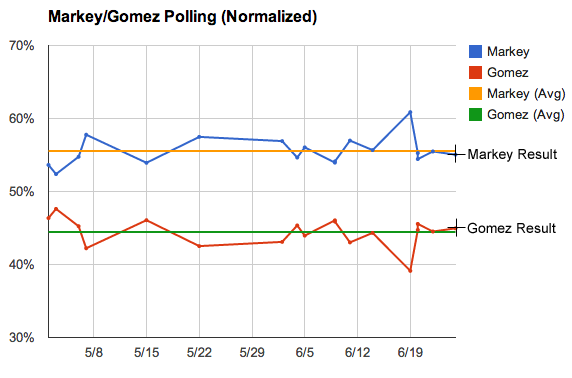

::: {.callout-note appearance="simple"}
Originally published on the [Mass. Numbers Blogger site](https://massnumbers.blogspot.com/2013/06/polling-average-nailed-markeygomez.html) on 2013-06-26.
:::

On Tuesday, June 25, Congressman Ed Markey defeated financier Gabriel Gomez with a 54.8% share of the vote to Gomez's 44.8% share. A [normalized polling average of the 17 independent polls](http://massnumbers.blogspot.com/p/ed-markeygabriel-gomez-massachusetts.html) of the race had Markey with 55.5% and Gomez with 44.5%, less than a percentage point difference.

While it is easy, in hindsight, to look back and pick the individual polls that were close to the final result, the result being close to the average of all polls is significant. Averaging polls smooths out differences in polling methodology and sampling variability and error, and gives a result over a much larger pool of voters. Using the average prevents us from needing a crystal ball to know which poll is significant, and which one is off base.

Political reporters or pundits will often quote the most recent poll, or sometimes cherry pick a poll that tells the story they are trying to tell. Many quoted the June 19 Herald poll with Markey up 20 points as a sign that Markey was on his way to a blowout. It is important to look at outliers like these in the context of the other polls, and polling averages give us a tool to better understand all of the data points.

In the following graph the yellow and green lines represent the final average of the normalized polling numbers and the black squares show the final results, just inside the average lines.

There is a great deal more analysis that can be done of the Markey/Gomez results, but it is clear that polling of the race and the resulting averages gave us a pretty clear picture of the state of the race before yesterday's voting.
