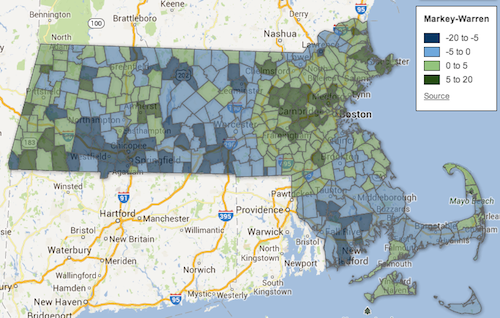
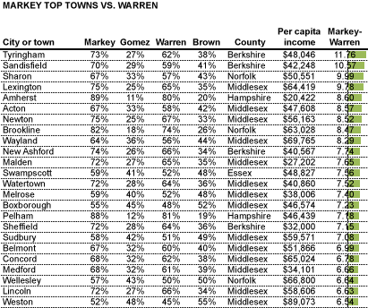
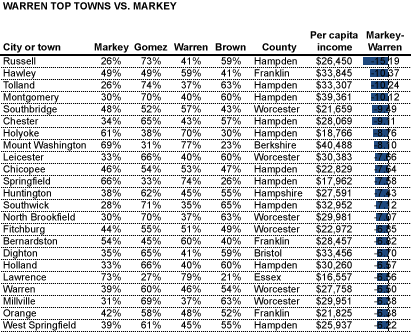
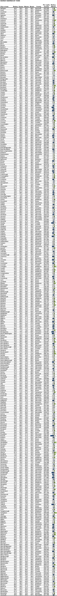

::: {.callout-note appearance="simple"}
Originally published on the [Mass. Numbers Blogger site](https://massnumbers.blogspot.com/2013/07/democrats-ed-markey-and-elizabeth.html) on 2013-07-01.
:::

While the last two elections for U.S. Senator in Massachusetts resulted in a 10 point victory by Ed Markey over Gabriel Gomez and an 8 point victory by Elizabeth Warren over Scott Brown, Markey and Warren showed that Democratic candidates for statewide office in Massachusetts can follow different paths to victory while appealing to somewhat different constituencies. Elizabeth Warren's populist message resonated in lower income areas, while Markey did better, on average, in affluent communities. Geographically, Warren did better than Markey in Central and Southwest Massachusetts, while Markey did better in far-Western Massachusetts and especially well in his native Metrowest region.

The following map shows the margin between Ed Markey's and Elizabeth Warren's percentage of the vote in each of the Commonwealth's 351 cities and towns—green indicates area of strength for Markey, and blue indicates area of strength for Warren (click on the map to open an interactive version):

::: {.callout-note appearance="simple"}
The interactive version of this map was built with Google Fusion Tables, which
Google shut down on 3 December 2019. Only the static image survives.
:::

A regression analysis of various demographic and geographic factors points to per-capita income and geography as highly correlated with the Markey-Warren margin.

**Per-Capita Income**

Elizabeth Warren's populist message of creating an even playing field for middle class families through increased Wall Street accountability, worked particularly well in lower income municipalities, while Ed Markey's message focusing on gun control and women's reproductive health combined with his long-time work on environmental issues appealed to more affluent voters. The candidates' appeal to different income demographics is also apparent when looking at simple averages—the towns and cities where Elizabeth Warren had a larger margin that Ed Markey had an average per-capita income of $31,246, while Markey's municipalities had an average per-capita income of $40,172.

**Geography**

While there was significant correlation between a voter's county and the Markey-Warren margin difference, the most striking difference was in the Boston Metrowest and Middlesex County area. This is not surprising given that this was home to Ed Markey's congressional district and is the area where he had the greatest name recognition. The other geographic differences may have been more a consequence of the income demographic discussed earlier.

**Towns with largest margin difference**

The towns where Markey outperformed Warren the most are dominated by high per-capita income towns in Boston's Metrowest region like Lexington, Acton, Concord and Wellesley, with a sprinkling of more affluent Western Massachusetts towns.

The areas where Warren out-performed Markey by the highest margins are primarily lower income towns in Southwest Massachusetts like Russell, Chicopee, and Springfield, with a sprinkling of Central Massachusetts cities and towns like Southbridge and Fitchburg.

**Complete City and Town Listing**

Here is a complete list of the Markey-Warren margins alphabetically by city and town.

