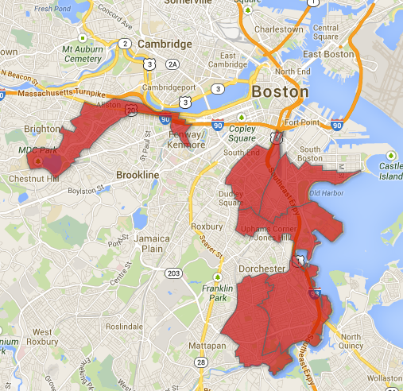
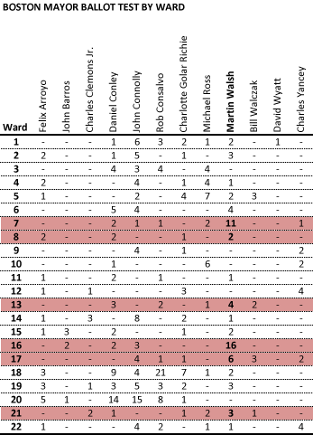

::: {.callout-note appearance="simple"}
Originally published on the [Mass. Numbers Blogger site](https://massnumbers.blogspot.com/2013/07/boston-mayoral-poll-shows-marty-walsh.html) on 2013-07-18.
:::

The recent [Suffolk University/Boston Herald poll of the race for Boston Mayor](http://www.suffolk.edu/news/19145.php#.UefM0GTF1tI) showed a race without a strong front-runner, with many candidates struggling for name recognition, and with 40% of the likely voters unwilling to choose a candidate to support. While City Councilor John Connolly was slightly ahead in the overall ballot test, State Representative Marty Walsh showed significant regional strength in areas in and around his district in Dorchester, in the South End, and also in Alston and Brighton.

The poll showed Walsh as the leader in Wards 7, 13, 16, 17, and 21, and tied for the lead in Ward 8. Walsh completely dominated wards 7 and 16, which significantly overlap his State Rep. district.

**Areas of strength for Rep. Marty Walsh**

The challenge for Rep. Walsh will be to build on these geographic areas of strength and expand his support into other areas of Boston.

Rob Consalvo also has a smaller district-based geographical bump in his home Ward of 18, and Daniel Conley and John Connolly dominate Ward 20, which holds their West Roxbury neighborhood. It will be interesting to see if this geographic divide holds in subsequent polls, and how the seeming deep support of Walsh in the area of his district plays out against John Connolly's shallower, but geographically wider support.

