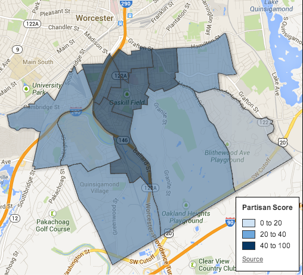
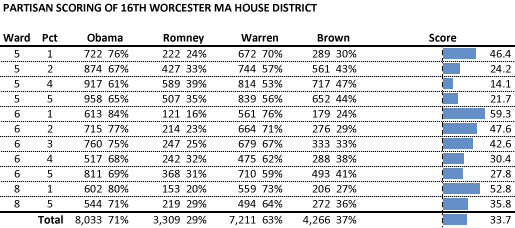
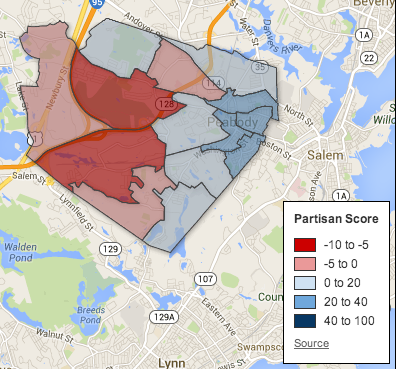
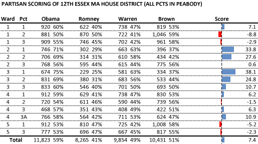
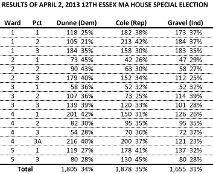

::: {.callout-note appearance="simple"}
Originally published on the [Mass. Numbers Blogger site](https://massnumbers.blogspot.com/2013/07/can-gop-win-16th-worcester-ma-house.html) on 2013-07-23.
:::

On May 22, Worcester State Representative John Fresolo resigned. Secretary of State William Galvin scheduled a special election to replace Fresolo with a primary on August 13 and the special election on September 10. There are [5 candidates facing off in the August Democratic primary](http://www.golocalworcester.com/news/worcester-16th-district-state-rep-candidates-who-can-win/)—Daniel Donahue, Khrystian King, Daniele Nanni, James O’Brien, and Joshua Perro. The Democratic winner will face off against Republican Carol Claros on September 10.

What are the chances of Republican Carol Claros to win over the eventual Democratic nominee? The Massachusetts GOP is hoping for some good news after a long series of losses. One recent bright spot for the MA GOP was political newcomer Leah Cole's win in Peabody in a special election on April 2 to replace Democratic State Representative Joyce Spiliotis. Some Republicans are [comparing the two races and candidates Cole and Claros](http://www.redmassgroup.com/diary/17063/onward-to-the-next-special-eleciton-help-carol-claros), and hoping Claros can reproduce the Cole special election win.

However, there are key differences between the 12th Essex seat won by Cole, and the 16th Worcester seat being sought by Claros. While the results of the special election will depend on which Democrat wins the primary and the strength and strategy of the campaigns, it is instructive to look at how Republican candidates typically fare in the 16th Worcester district, and to compare with historical results in the Peabody-based 12th Essex district now held by Rep. Cole.

**The 16th Worcester MA House District**

The 16th Worcester Massachusetts House District encompasses much of the south side of Worcester from South Worcester, Vernon Hill, and Grafton Hill, down through Broadmeadow and Quinsigamond Village. The 2012 Presidential election returns for the district give the impression of an overwhelmingly Democratic electorate.

The score of each precinct, and the district as a whole, is calculated by averaging the margins of the Presidential and Senate races.

President Obama averaged 71% of the vote and Senator Warren 63% of the vote for the district, and the average margin for all of the precincts is a 33.7 point advantage for Democrats. This is a solidly Democratic district.

**The 12th Essex MA House District**

The 2012 results from the 12th Essex District are quite a bit different. Five of the 15 district precincts had a higher average margin for Republicans than Democrats, and Scott Brown won the district with 51% to Elizabeth Warren's 49%.

While the scoring mechanism of averaging the margins gives a 7.4 point advantage to Democrats overall, we occasionally see this type of district being won by a Republican, as happened in the Leah Cole victory.

Republican Leah Cole defeated Democrat Beverley Ann Griffin Dunne and Independent David Gravel (while Gravel ran as an Independent, he pledged during the campaign to caucus with House Democrats, if elected). Cole's final margin over Dunne was 73 votes. The three-way nature of the race may have played a role in the outcome—Cole's campaign acknowledged that they saw an opportunity to divide the Democratic vote between Dunne and Gravel as they both identified ideologically as Democrats.

**Can Carol Claros win in the 16th Worcester District?**

While Leah Cole emerged victorious in the April 2 special election, it is unlikely that Carol Claros can repeat this GOP success without a great deal of help and Democratic bad luck. There are numerous instances where Republican State Rep. candidates have won elections in slightly Democratic-leaning districts, [but they are relatively uncommon](../2012-11-18-house-district-partisan-ranking/index.qmd). Moreover, I don't know of any Massachusetts Republican State Rep. candidate that has succeeded in a district that gives 34 point advantages to national Democratic candidates.

Republicans feel that they have a strong candidate with Carol Claros, but it will likely take a serious misstep by the eventual Democratic nominee to provide a GOP victory on September 10.
