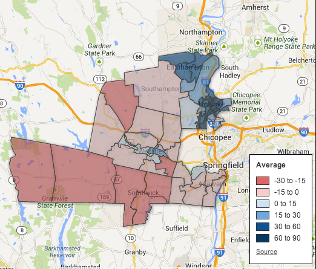
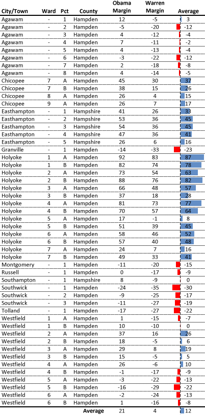

::: {.callout-note appearance="simple"}
Originally published on the [Mass. Numbers Blogger site](https://massnumbers.blogspot.com/2013/08/knapik-resignation-leaves-opening-for.html) on 2013-08-06.
:::

Republican State Senator Mike Knapik of Westfield has announced that he is resigning his 2nd Hampden and Hampshire seat to take a position at Westfield State University. Analysis of 2012 Presidential and Senate results in Knapik's district shows an opening for a strong Democratic candidate to win the seat in the upcoming special election. President Obama won the district by 21 points and Senator Warren defeated Scott Brown by 4 points in the district.

However, the district is not necessarily a slam dunk for the Democratic nominee in the upcoming special election. The Democratic votes in the district are concentrated in the more populated areas of Holyoke and Easthampton, while the Republican votes are in the more rural and suburban southwestern parts of the district. It may be difficult to achieve turnout levels in Holyoke and Easthampton that match the traditionally higher special election turnout in the suburbs.

There is a [detailed article on Blue Mass Group](http://bluemassgroup.com/2013/08/state-senator-michael-knapik-to-resign-who-will-succeed-him/) examining some of the possible candidates for the position, including Republican State Rep. Donald Humason, who has already put his hat into the ring, and Democratic State Rep. Aaron Vega of Holyoke. A run by Vega would likely help with Democratic turnout, given his strength and name recognition in Holyoke.

**Average of Obama and Warren Margins**(click for interactive map)

::: {.callout-note appearance="simple"}
The interactive version of this map was built with Google Fusion Tables, which
Google shut down on 3 December 2019. Only the static image survives.
:::

**Precinct-by-precinct results for 2nd Hampden and Hampshire district**

