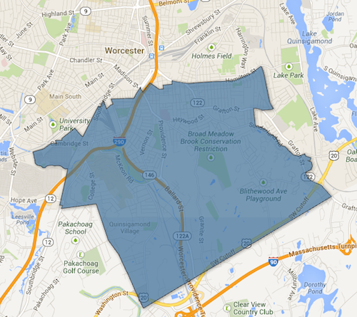
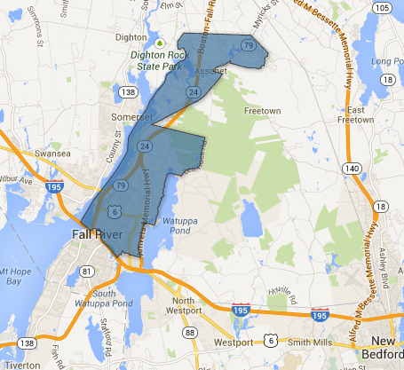

::: {.callout-note appearance="simple"}
Originally published on the [Mass. Numbers Blogger site](https://massnumbers.blogspot.com/2013/08/three-special-state-primaries-for-three.html) on 2013-08-12.
:::

All three of the districts are comfortably Democratic. Tomorrow's special primaries may very well determine the winner of all of the races. The fundraising numbers are the receipts and expenditures numbers from the [pre-primary reports on OCPF](http://ocpf.cloudapp.net/Filers/SpecialElections).

**Twelfth Suffolk State Representative District**

Previously held by Senator Linda Dorcena Forry who resigned after being elected as State Senator for the First Suffolk district. The district is overwhelmingly Democratic—ranked 6/160—with President Obama winning the district by 80 points and Senator Warren beating Scott Brown by 72 points.

- Dan Cullinane (D) - Field director for Forry campaign - [http://www.dancullinane.com/](http://www.dancullinane.com/) - raised: $16,915, spent: $15,430

- Stephanie Everett (D) - Executive Director for Multi Boards with the Massachusetts Department of Public Health - [http://stephanieeverett.com/](http://stephanieeverett.com/) - raised: $1,620, spent: $3,731

- Marydith Tuitt (D) - Navy veteran - [http://vote4mary.net/](http://vote4mary.net/) - raised: $1,630, spent $2,283

**Sixteenth Worcester State Representative District**

Previously held by Rep. John Fresolo who resigned the seat. The district is very Democratic—ranked 48/160—with President Obama winning the district by 42 points and Senator Warren beating Scott Brown by 26 points.

- Daniel Donahue (D) - Director of Policy and Assistant Chief of Staff to Worcester Mayor Joe Petty - [http://dandonahue.org/](http://dandonahue.org/) - raised: $12,506, spent: $2,850

- Khrystian King (D) - Social Worker with the Department of Children and Families - [http://king4staterep.com/](http://king4staterep.com/) - raised: $2,143, spent: $4,037

- Daniele Nanni (D) - Pharmacy Buyer for Critical Care Systems in Shrewsbury - [Facebook](https://www.facebook.com/pages/Daniele-Nanni/279176745562212) - raised: $4,775, spent: $4,173

- James O'Brien (D) - Human Services Manager and Real Estate Agent - [http://www.jimobrienforrep.com/](http://www.jimobrienforrep.com/) - raised: $850, spent: $3,285

- Joshua Perro (D) - Junior at Clark University studying Political Science and Economics - [http://www.joshperro.com/](http://www.joshperro.com/) - raised: $6,225, spent: $6,400

- Carol Claros (R) - Nurse - [http://www.carolclaros.com/](http://www.carolclaros.com/) - raised: $6,660, spent: $3,129

[This previous article](../2013-07-23-sixteenth-worcester-special/index.qmd) provides more specifics about the district and the likelihood of GOP win for Claros.

**Sixth Bristol State Representative District**

Previously held by Rep. David Sullivan who resigned to take a position with the Fall River Housing Authority. The district is very Democratic—ranked 49/160—with President Obama winning the district by 40 points and Senator Warren beating Scott Brown by 26 points.

- David Dennis (D) - Fall River City Councilor - [http://www.davidjdennis.com/](http://www.davidjdennis.com/) - raised: $0, spent: $2,085

- Carole Fiola (D) - Former Governor's Councillor - [http://electcarole.com/](http://electcarole.com/) - raised: $2,640, spent: $19,960

- Brad Kilby (D) - Fall River City Councilor - [Facebook](https://www.facebook.com/pages/Brad-Kilby-for-State-Representative/104223756438963) - raised: $3,290, spent: $3,237

- Gerald Potvin (D) - Department of Transportation employee - [Facebook](https://www.facebook.com/GoGerryPotvin) - raised: $200, spent: $1,078

- David Steinhof (R) - Dentist - [http://www.davidsteinhof.com/](http://www.davidsteinhof.com/) - raised: $2,790, spent: $1,918

Note Carole Fiola's expenditures of $19,960 including $11,000 on printing and $2,600 on radio advertising.
