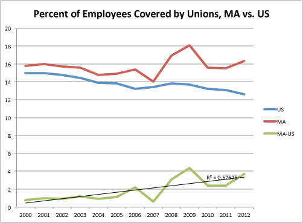

::: {.callout-note appearance="simple"}
Originally published on the [Mass. Numbers Blogger site](https://massnumbers.blogspot.com/2013/09/massachusetts-union-membership.html) on 2013-09-02.
:::

Union membership has been steadily declining in the United States since the 1970s and shows few signs of slowing at a national level as more states establish restrictions on public employee and other labor unions.

While Massachusetts did have a similar plunge in union membership from the 1970s through the early 2000s, there has been a recent uptick in union employee coverage. The increase began in 2007, starting from a low below 14% to a current level above 16%. The recent maximum was a coverage level of 18%, achieved in 2009.

This graph shows the overall U.S. percentage of union employee coverage vs. that in Massachusetts (source: [Bureau of Labor Statistics](http://www.bls.gov/)), including a trend line showing increasing union membership in the Commonwealth compared to the nation as a whole.

