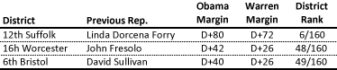
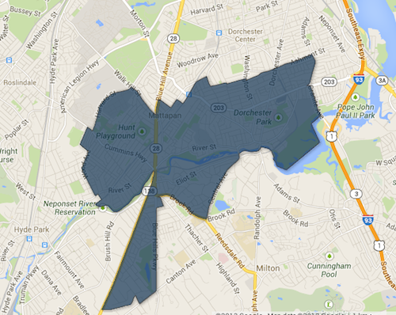

::: {.callout-note appearance="simple"}
Originally published on the [Mass. Numbers Blogger site](https://massnumbers.blogspot.com/2013/09/partisan-rankings-for-tomorrows-three.html) on 2013-09-09.
:::

On Tuesday, September 10 there will be three special elections to fill vacant State Representative seats, the 12th Suffolk District in Dorchester, the 16th Worcester District in the southern part of Worcester, and the 6th Bristol District in Fall River. The 12th Suffolk is overwhelmingly liberal and Democratic and should be a sure win for Dan Cullinane. President Obama and Senator Warren won both the 16th Worcester and 6th Bristol by very large margins, and wins by Daniel Donahue and Carole Fiola are also likely.

**12th Suffolk State Representative District**

Previously held by Senator Linda Dorcena Forry who resigned after being elected as State Senator for the First Suffolk district. The district is overwhelmingly Democratic—ranked 6/160—with President Obama winning the district by 80 points and Senator Warren beating Scott Brown by 72 points.

- Dan Cullinane (D) - Should win handily in one of the most Democratic districts in the Commonwealth - [http://www.dancullinane.com/](http://www.dancullinane.com/)

- Lincoln Larmond (I) - [http://lincolnlarmond.com/](http://lincolnlarmond.com/)

- Edmond Romulus (U) - [http://www.edmondromulus.com/](http://www.edmondromulus.com/)

**16th Worcester State Representative District**

Previously held by Rep. John Fresolo who resigned the seat. The district is very Democratic—ranked 48/160—with President Obama winning the district by 42 points and Senator Warren beating Scott Brown by 26 points.

- Carol Claros (R) - Considered a promising candidate by Republicans, a long-shot in this heavily Democratic district - [http://www.carolclaros.com/](http://www.carolclaros.com/)

- Daniel Donahue (D) - Director of Policy and Assistant Chief of Staff to Worcester Mayor Joe Petty - [http://dandonahue.org/](http://dandonahue.org/)

**6th Bristol State Representative District**

Previously held by Rep. David Sullivan who resigned to take a position with the Fall River Housing Authority. The district is very Democratic—ranked 49/160—with President Obama winning the district by 40 points and Senator Warren beating Scott Brown by 26 points.

- Carole Fiola (D) - The well-financed campaign of this former Governor's Councillor member is likely to prevail in this heavily Democratic district - [http://electcarole.com/](http://electcarole.com/)

- David Steinhof (R) - Dentist - [http://www.davidsteinhof.com/](http://www.davidsteinhof.com/)
