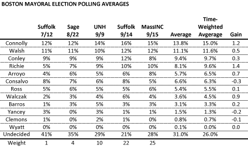

::: {.callout-note appearance="simple"}
Originally published on the [Mass. Numbers Blogger site](https://massnumbers.blogspot.com/2013/09/boston-mayor-polling-averages-show-john.html) on 2013-09-19.
:::

Recent polls by WBUR/MassINC and Boston Herald/Suffolk, when taken together and averaged with previous polling, show City Councilor John Connolly as a clear leader in the Boston mayoral race, with a strong likelihood of surviving as one of the two first-round winners on September 24. State Representative Marty Walsh has held a consistent second place spot in the polls, but is seeing pressure from former State Rep. Charlotte Golar Richie, who has shown the biggest gains between the earliest polls and this week's surveys. Suffolk District Attorney Dan Conley holds third place in the averages, but has been losing ground to Richie.

The time-weighted average, which gives larger weights to more recent polls, has Connolly at 15.0%, Walsh with 11.6%, and Conley and Richie virtually tied at 9.7% and 9.6%, respectively. The *Gain* column in the table shows the difference between the time-weighted average and the straight average, giving some indication of momentum and gain in more recent polls.

The next tier of candidates above 6% are City Councilors Felix Arroyo and Rob Consalvo. Arroyo has shown some gains in later polls and Consalvo has had a small drop-off.

While there is always a chance that the polling is flawed, or there are large pockets of unpolled voters that could put Mike Ross, Bill Walczak, or the Boston Globe-endorsed John Barros in the top two on election day, it is unlikely, given the consistency of the polls from July through September. Walczak has shown the most momentum from this group, while Ross has shown a consistent 5 to 6% in every poll.
