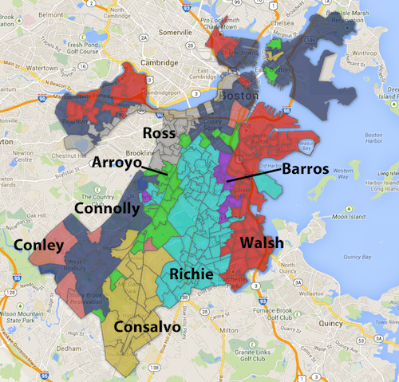
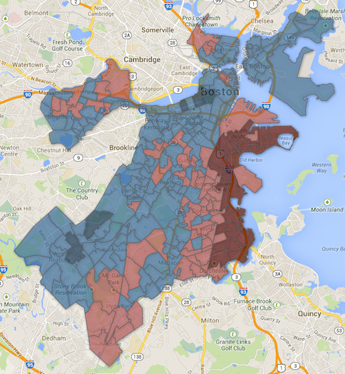

::: {.callout-note appearance="simple"}
Originally published on the [Mass. Numbers Blogger site](https://massnumbers.blogspot.com/2013/09/a-map-of-boston-mayoral-precinct.html) on 2013-09-26.
:::

State Representative Marty Walsh and City Councilor John Connolly were the winners of the preliminary mayoral election, but a map highlighting the winner of each precinct shows that other candidates were able to show regional strength. An endorsement of either winner by any of the other regional winners could make a difference in the general election.

**Precinct-by-precinct winners (click for interactive)**

::: {.callout-note appearance="simple"}
The interactive version of this map was built with Google Fusion Tables, which
Google shut down on 3 December 2019. Only the static image survives.
:::

Walsh and Connolly did take the majority of the votes in major swaths of the city, Walsh concentrated in his district home in Dorchester and up through South Boston, and Connolly around his home of West Roxbury and also up into Copley and extending to East Boston.

Suffolk District Attorney Dan Conley won areas of West Roxbury and City Councilor Rob Consalvo ran strong in his home area of Hyde Park.

Former State Representative Charlotte Golar Richie dominated in Roxbury, and John Barros was the top vote getter around his home area of Dudley Street.

City Councilor Felix Arroyo took home the most votes in Forest Hills and surrounding areas, and City Councilor Mike Ross did well in the area around his Back Bay city council district.

**Walsh vs. Connolly Strength**

The next map shows the difference between the Walsh and Connolly voter percentage in each of Boston's precincts.

**Walsh vs. Connolly strength (click for interactive)**

::: {.callout-note appearance="simple"}
The interactive version of this map was built with Google Fusion Tables, which
Google shut down on 3 December 2019. Only the static image survives.
:::

John Connolly was ahead of Marty Walsh 153 precincts, by an average of 10 points. Walsh beat Connolly in 102 precincts, but by a larger average of 16 points, accounting for his overall win.

Connolly's best precinct over Walsh was Ward 5, Precinct 3 on Beacon Hill, where his margin was 35 points. Walsh's best precinct over Connolly was Ward 16, Precinct 12 around Pope John Paul II Park in Dorchester where he beat Connolly by a whopping 70 points.

Walsh can once again win in the general election by winning fewer precincts overwhelmingly, but support from any of the regional winners could go a long way towards a win for either candidate.
