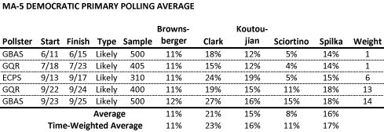
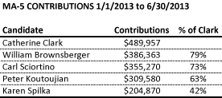
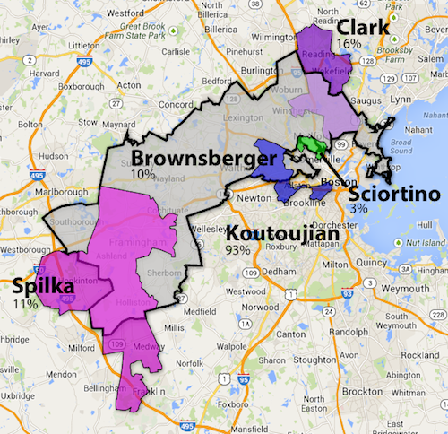
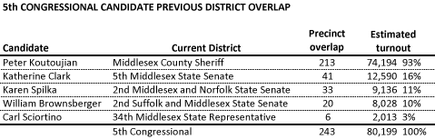

::: {.callout-note appearance="simple"}
Originally published on the [Mass. Numbers Blogger site](https://massnumbers.blogspot.com/2013/09/a-look-at-polling-averages-fundraising.html) on 2013-09-30.
:::

The Democratic primary to fill the Massachusetts 5th Congressional seat vacated by Senator Ed Markey has drawn a deep and talented field, unsurprising given the safe Democratic nature of the seat (Obama +33, Warren +18) and the rarity of such an opening. The candidates include State Senator William Brownsberger of Belmont, State Senator Katherine Clark of Melrose, Middlesex Sheriff Peter Koutoujian of Newton, State Representative Carl Sciortino of Medford, and State Senator Karen Spilka of Ashland.

There has been only one public poll not affiliated with a campaign (from Emerson College Polling Society), but an average of all of the published polling numbers shows State Senator Katherine Clark as the leader. While Sciortino had been coming in below the other major candidates, the early polling came before his [strong Tea-Party Dad advertisement](http://www.youtube.com/watch?v=Z3S1zcbWkoM), which captured national attention and seems to have had an effect on likely voters. Sciortino surpassed Will Brownsberger in the latest Gerstein Bocian Agne Strategies poll.

Katherine Clark is also leading in fundraising, as reported in the FEC reports covering January 1 through June 30. Brownsberger and Sciortino are clustered at around 75% of Clark's total, Koutoujian is at 63%, and Spilka is far behind at well under half of Clark's total with 42%.

**District overlap**

Many of the 5th Congressional District voters have already seen one or more of these candidates on the ballot, and possibly voted for one of the candidates for State Rep., State Senator, or Sheriff. A full 93% of expected voters have seen Middlesex Sheriff Peter Koutoujian's name on a ballot in 2012, with smaller overlaps for Clark at 16%, 11% for State Senator Karen Spilka, 10% for State Senator William Brownsberger, and 3% for State Representative Carl Sciortino.

**Existing district overlap (click for interactive map)**

::: {.callout-note appearance="simple"}
The interactive version of this map was built with Google Fusion Tables, which
Google shut down on 3 December 2019. Only the static image survives.
:::

The estimated number of voters are based on the primary voters from each precinct who voted in the Markey/Lynch Democratic primary in April.

Additional polling will help determine whether Carl Sciortino has been able to overcome his early low showing in the polls and lack of name recognition with his entertaining and powerful television advertisement. Katherine Clark has shown a consistent early lead in polling and fundraising, but the remaining candidates are within striking distance in what will likely be another low-turnout special election primary.

**Poll listing**

- [Gerstein Bocian Agne Strategies](http://www.scribd.com/doc/172535945/MA-05-GBA-Strategies-for-Katherine-Clark-Sept-2013), 6/11-6/15, Clark internal

- [Greenberg Quinlan Rosner Research](http://www.bostonmagazine.com/news/blog/2013/07/29/spilka-internal-poll-has-women-in-charge/), 7/18-7/23, Spilka internal

- [Emerson College Polling Society](http://emersoncollegepollingsociety.com/ECPS_Press_release_9.20.pdf), 9/13-9/17, public poll

- [Public Policy Polling](http://www.masslive.com/politics/index.ssf/2013/09/poll_carl_sciortino_leads_5th.html), 9/22-9/23, Sciortino internal - not included because full top-lines were not provided

- [Greenberg Quinlan Rosner Research](http://www.bostonmagazine.com/news/blog/2013/09/25/tea-party-dad-video-boost-carl-sciortino/), 9/22-9/24, Spilka internal

- [Gerstein Bocian Agne Strategies](http://www.bostonmagazine.com/news/blog/2013/09/30/katherine-clark-campaign-sees-pulling-away/), 9/23-9/25, Clark internal
