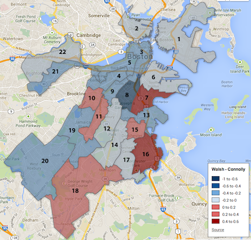
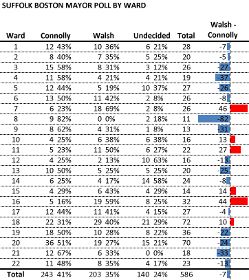

::: {.callout-note appearance="simple"}
Originally published on the [Mass. Numbers Blogger site](https://massnumbers.blogspot.com/2013/10/suffolk-mayoral-poll-gives-first-look.html) on 2013-10-08.
:::

On October 7 the Suffolk University Political Research Center released the [first head-to-head Boston mayoral poll](http://www.suffolk.edu/academics/10732.php) between City Councilor John Connolly and State Representative Marty Walsh. The poll showed Connolly with a 7 point advantage at 41%, Walsh at 34%, and 23% of the voters undecided. An analysis of the ward-by-ward cross-tabs allows us to get a feel for the possible regional strengths of each candidate. Note that the sample sizes for each ward are quite small, so any conclusions should be taken with a grain of salt.

**Suffolk poll ward-by-ward results (click for interactive map)**

::: {.callout-note appearance="simple"}
The interactive version of this map was built with Google Fusion Tables, which
Google shut down on 3 December 2019. Only the static image survives.
:::

Walsh showed strength around his home district and throughout Dorchester, stringing together Wards 7, 15, and 16, by sizable margins. Walsh also polled above Connolly in Ward 10—won by City Councilor Mike Ross in the preliminary election, Ward 11—where Felix Arroyo and Charlotte Golar Richie won the precincts, and Ward 18 which was split between Rob Consalvo and Richie in September.

The poll showed Connolly ahead in more wards and he made inroads in the South End's Ward 6, which was won by Walsh in the preliminary. He also had strong showings in his home neighborhood of West Roxbury and was again tops in the Back Bay. Connolly's biggest advantage was in Ward 8 where Walsh did not receive any support, albeit with a sample size of 11 probable voters.

A comparison of this poll map with the [map of precinct-by-precinct preliminary election winners](../2013-09-26-boston-mayoral-precinct-winners/index.qmd), shows the importance of an endorsement of Walsh or Connolly by one of the other major vote-getters like Richie, Arroyo, Ross, or Consalvo. While the 7 point lead in the Suffolk survey by Connolly is significant, there is still time and room for Walsh to bridge the gap.

