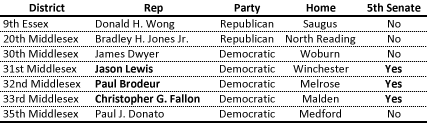
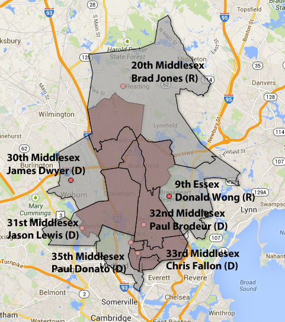

::: {.callout-note appearance="simple"}
Originally published on the [Mass. Numbers Blogger site](https://massnumbers.blogspot.com/2013/10/clarks-5th-middlesex-senate-district.html) on 2013-10-16.
:::

On Tuesday, October 15 Katherine Clark handily won the Democratic primary to replace Ed Markey as U.S. Representative for the Fifth Congressional District. While Clark still needs to win the general election on December 10 against Republican Frank Addivinola, there is very little doubt in the outcome as President Obama won the district by 33 points and Elizabeth Warren won it over Scott Brown by 18 points.

The cascading effect of special elections will continue, as Clark's 5th Middlesex state senate district becomes vacant. Local State Representatives often run for open State Senate seats, leading us to look at the state representative districts that overlap the 5th Middlesex senate district.

There are seven House districts overlapping the 5th Middlesex Senate District. Two of the seats are represented by Republicans: Donald Wong (Saugus) and Minority Leader Brad Jones (North Reading). Four of the seats are represented by Democrats: James Dwyer (Woburn), Jason Lewis (Winchester), Paul Brodeur (Melrose), Christopher Fallon (Malden), and Paul Donato (Medford).

Only Representatives Lewis, Brodeur, and Fallon reside within the 5th Middlesex District, qualifying them to run for the upcoming vacancy.

**(click for interactive map)**

::: {.callout-note appearance="simple"}
The interactive version of this map was built with Google Fusion Tables, which
Google shut down on 3 December 2019. Only the static image survives.
:::

