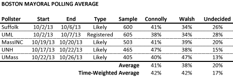
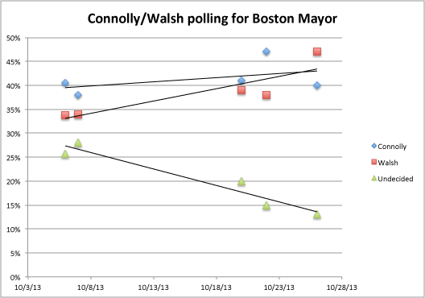
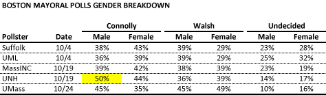

::: {.callout-note appearance="simple"}
Originally published on the [Mass. Numbers Blogger site](https://massnumbers.blogspot.com/2013/10/boston-mayoral-polling-average-shows.html) on 2013-10-31.
:::

*[Note: See [this polling average update](../2013-11-01-walsh-overtakes-connolly/index.qmd) that includes the last Suffolk University poll.]*

City Councilor John Connolly was the early leader in the polling of voters in the head-to-head race for Boston Mayor against State Representative Marty Walsh, but Marty Walsh has surpassed Connolly in the latest UMass poll and a time-weighted average shows a tie with each candidate carrying 42% of the vote.

A graph of the polling numbers with fitted linear regression trend lines shows what seems to be an outlier in Connolly's number of 47% in the UNH poll. A graphical representation of the poll numbers with a regression trend line emphasizes the outlying nature of the point.

Statistical fit measurements confirm that the trend line for Connoly is not very reliable (R-squared of 0.2) compared to the goodness of fit measurements for the Walsh (R-squared of 0.8) and Undecided (R-squared of 0.9) trend lines. While more data would be needed to make a definitive statement, one explanation would be consistent numbers around 40% for Connolly and rising numbers from mid-30s to mid-40s for Walsh.

A look at the gender breakdown in the polls shows Connolly and Walsh approximately tied with men in all but the UNH poll, which has Connolly with a 14 point advantage among males, a number that is way out of line with the other polls. There is a fairly steady trend upwards with women supporters of Walsh.

There is not enough consistency in the polling to declare a strong favorite in the race to replace Mayor Menino. It *is* clear that Walsh has made headway against the early lead held by Connolly, but it is not clear whether the race is tied, or Walsh has moved into the lead.
