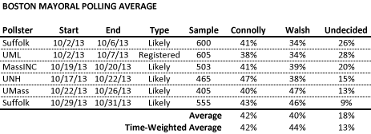
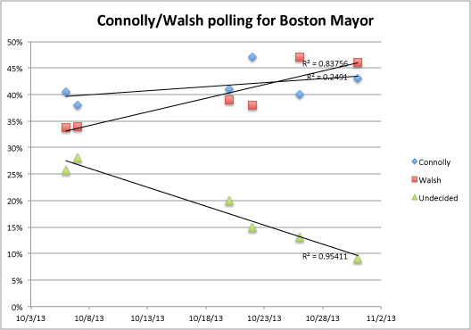

::: {.callout-note appearance="simple"}
Originally published on the [Mass. Numbers Blogger site](https://massnumbers.blogspot.com/2013/11/suffolk-poll-provides-more-evidence.html) on 2013-11-01.
:::

A [new poll from Suffolk University](http://www.suffolk.edu/news/23743.php#.UnP35pTF3SE%20http://www.suffolk.edu/news/25738.php#.UnP42ZTF3SE) conducted less than a week before the November 5 election shows State Representative Marty Walsh with a 3 point lead over City Councilor John Connolly and provides more evidence that Walsh is now leading the race. A time-weighted polling average has also tipped in Walsh's favor, giving him a 2 point lead of 44% to 42%.

A graph of the polling numbers fitted with linear regression lines shows a clear rise for Walsh from the low 30s in early October, to the mid 40s this week. The fit for the Connolly line shows a slight rise, but with much less confidence in the fit. The graph, trend line, and analysis of the cross-tabs calls the the UNH poll number for Connolly into question—whether it resulted from a methodological difference or just an unlucky sample, the number does not fit well with the other polling.

Polls used in average:

- [Herald/Suffolk, 10/7/2013](http://www.suffolk.edu/news/23743.php#.UnP4jpTF3SE)

- [UMass Lowell, 10/10/2013](http://www.uml.edu/Research/Centers/public-opinion/polls/Boston-Mayoral-Election-Oct2013/default.aspx)

- [WBUR/MassINC, 10/23/2013](http://www.wbur.org/2013/10/23/wbur-connolly-walsh-mayoral-poll)

- [Globe/UNH, 10/24/2013](http://www.bostonglobe.com/metro/2013/10/23/john-connolly-holds-percentage-point-lead-over-martin-walsh-new-globe-poll-even-race-remains-fluid/KHhsPiuPRPa7pkjRKTJTiL/story.html)

- [UMass Amherst, 10/30/2013](http://www.umass.edu/newsoffice/article/new-umass-poll-shows-walsh-taking-lead)

- [Herald/Suffolk, 11/1/2013](http://www.suffolk.edu/news/25738.php#.UnP42ZTF3SE)
