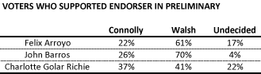
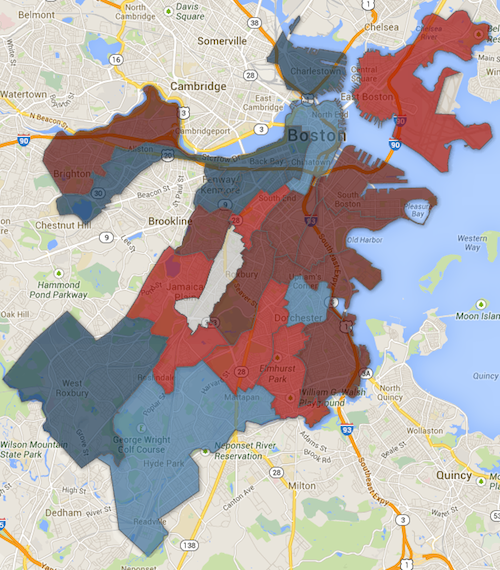
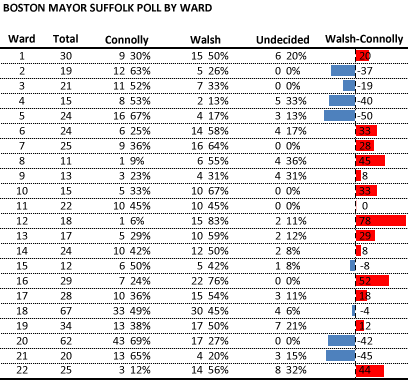

::: {.callout-note appearance="simple"}
Originally published on the [Mass. Numbers Blogger site](https://massnumbers.blogspot.com/2013/11/suffolk-poll-suggests-boston-mayoral.html) on 2013-11-04.
:::

The [most recent poll from Suffolk University](http://www.suffolk.edu/news/25738.php#.UnP42ZTF3SE) for the November 5 Boston mayoral election suggest that endorsements of State Representative Marty Walsh by preliminary candidates Felix Arroyo, John Barros, and Charlotte Golar Richie are helping Walsh. The poll shows Walsh leading with voters that voted for each of those endorsing candidates, and a look at the ward-by-ward geography shows Walsh consolidating the geographic areas won by his endorsers.

The survey shows a strong lead for Walsh among voters that voted for Arroyo and Barros in the preliminary election, and a smaller lead among Golar Richie voters. A ward-by-ward map of the Suffolk results shows Walsh starting to consolidate the [areas won by his endorsers](../2013-09-26-boston-mayoral-precinct-winners/index.qmd).

**SUFFOLK WARD-BY-WARD RESULTS (click for interactive map)**

::: {.callout-note appearance="simple"}
The interactive version of this map was built with Google Fusion Tables, which
Google shut down on 3 December 2019. Only the static image survives.
:::

