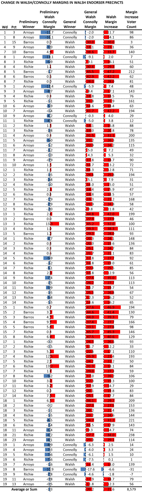

::: {.callout-note appearance="simple"}
Originally published on the [Mass. Numbers Blogger site](https://massnumbers.blogspot.com/2013/11/endorsements-of-walsh-by-arroyo-barros.html) on 2013-11-07.
:::

State Representative Marty Walsh defeated City Councilor John Connolly by a margin of 4,908 votes in Tuesday's general election and an analysis of the precinct-by-precinct results show clearly that Walsh's endorsements by preliminary candidates Felix Arroyo, John Barros, and Charlotte Golar Richie had a profound effect on the outcome of the race.

Of the 93 precincts won by Arroyo, Barros, and Richie in the preliminary, Walsh won 81 of those precincts in the general election by a total of 7,859 votes. It is unlikely that Walsh would have done as well in those precincts without the endorsements. A comparison of the Walsh and Connolly voter share in the preliminary had Connolly ahead of Walsh in 55 of the 93 precincts, but in the general election, Connolly was ahead in only 12 of the 93 precincts.

Walsh's margin over Connolly increased between the preliminary and general election in all but two precincts. His average increase in margin was 21.6 points across all 93 precincts. Multiplying the increase in voter share between Walsh and Connolly in the preliminary times the number of general election voters on a precinct-by-precinct basis, shows that Walsh increased share amounted to 8,579 votes. We do not have the data to attribute all of those voters to the endorsements, but it is not inconceivable that a large fraction of Walsh's 4,908 Boston-wide margin were influenced by the Arroyo, Barros, and Richie endorsements.

The table shows each precinct won by an endorser, the margin between Walsh and Connolly in the preliminary, the general election winner, the margin between Walsh and Connolly in the general, Walsh's increase in margin between the preliminary and general, the a count of the general election votes that increase in margin represents.

