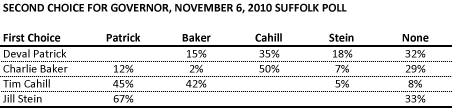

::: {.callout-note appearance="simple"}
Originally published on the [Mass. Numbers Blogger site](https://massnumbers.blogspot.com/2013/11/it-is-not-clear-that-independent.html) on 2013-11-21.
:::

A recent article in the Boston Globe—[Independents may complicate Baker’s bid](http://www.bostonglobe.com/metro/2013/11/21/independent-candidates-pose-problems-for-baker-candidacy-for-governor/bpjgqepYgEhs5Mve9oaSbI/story.html)—attempts to make the case the independent candidates for Massachusetts Governor, like Jeffrey McCormick, might swing the 2014 race by taking votes from Republican Charlie Baker. A similar claim was made in the 2010 gubernatorial race about independent candidate Tim Cahill, but polling just before the election shows Cahill supporters were evenly split between Deval Patrick and Charlie Baker, making him a non-factor in the race.

Conventional wisdom in 2010 was that Tim Cahill's candidacy split the anti-incumbent vote and allowed Deval Patrick to beat Charlie Baker. However, a Suffolk University poll conducted just before the election showed Deval Patrick slightly ahead of Charlie Baker as the second choice for Cahill voters. In addition, all of the Jill Stein voters who had a second choice, chose Deval Patrick.

The poll would seem to indicate that Cahill was likely a non-factor, taking an even number of votes from Patrick and Baker, while Stein probably took votes only from Patrick (albeit a small number of votes given Stein's 1.4% share of the vote on election day).

While every race is different and McCormick or another candidate might be a factor in 2014, it is prudent to remember that independent and third-party candidates have not ended up playing a large roll in recent Massachusetts elections.

For additional discussion on what recent history says about Charlie Baker's chances in 2014, see my piece in the latest issue of Commonwealth Magazine:

*[The GOP's corner office strategy](http://www.commonwealthmagazine.org/Departments/Statistically-Significant/2013/Fall/001-The-GOPs-corner-office-strategy.aspx)*
