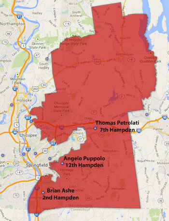
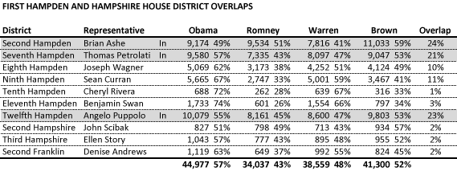

::: {.callout-note appearance="simple"}
Originally published on the [Mass. Numbers Blogger site](https://massnumbers.blogspot.com/2014/01/reps-ashe-petrolati-and-puppolo-could.html) on 2014-01-21.
:::

Shira Schoenberg [reported on January 20](http://www.masslive.com/politics/index.ssf/2014/01/state_sen_gale_candaras_to_ann.html) that State Senator Gale Candaras plans to run for Hampden Register of Probate in 2014, rather than for reelection to the State Senate. While there are ten State Representative districts that overlap with Candaras's First Hampden and Hampshire State Senate district, only three sitting Representatives live inside the district—Brian Ashe (D-Longmeadow), Thomas Petrolati (D-Ludlow), and Angelo Puppolo (D-Springfield)—any of whom could run for the seat.

**FIRST HAMPDEN AND HAMPSHIRE RESIDING REPS**

In the 2012 Presidential Election 24% of the First Hampden and Hampshire votes came from Ashe's Second Hampden Rep. district, 23% from Puppolo's Twelfth Hampden, and 21% from Petrolati's Seventh Hampden, so none of the three enjoy a tremendous advantage in terms of the number of senate district voters who have seen their name on the ballot. The State Senate district gave President Obama a +14 two-party margin of victory, but Elizabeth Warren lost the district to Scott Brown in a -4 two-party margin loss.

Rep. Ashe's Second Hampden portion of the State Senate district was the only Rep-district overlap where President Obama actually lost to Romney (49%-51%)—unsurprising given the regional conservatism of the Western Massachusetts towns along the southern border with Connecticut.

Conventional wisdom points against a run for State Senate by Rep. Petrolati, who figures in the [Ware probation patronage investigation](http://www.masslive.com/news/index.ssf/2010/11/ware_report_massachusetts_prob.html).

Rep. Puppolo has an enviable campaign war chest with over $225,000 to spend. While the State Senate district is not overwhelmingly Democratic, Puppolo's money could be a deciding factor in a race against Republican Debra Boronski of East Longmeadow, who has already declared her intention to run for the First Hampden and Hampshire seat.
