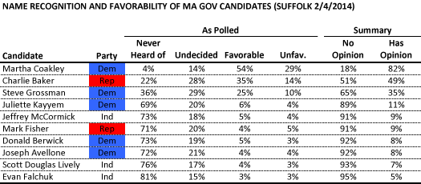

::: {.callout-note appearance="simple"}
Originally published on the [Mass. Numbers Blogger site](https://massnumbers.blogspot.com/2014/02/ma-governor-polling-takeaway-low-name.html) on 2014-02-04.
:::

The race to replace Deval Patrick as Massachusetts Governor has begun to take shape with five Democrats, two Republicans, and three independent candidates indicating their a candidacy. The press release and news coverage of the [latest poll from Suffolk University and the Boston Herald](http://www.suffolk.edu/academics/10732.php) plays up the head-to-head match-ups between Democratic Attorney General Martha Coakley, Republican former Massachusetts Secretary of Administration and Finance Charlie Baker, and other candidates. However, the polling shows that the vast majority of the Massachusetts voters have never heard of most of the candidates and only Coakley is known well enough that a majority of voters have a favorable or unfavorable opinion.

The Suffolk poll asked respondents to judge the candidates favorably or unfavorably, allowing them to opt out as having never heard of the candidate, or as not yet having an opinion of the candidate. I have divided the respondents into *Has Opinion* (for favorable or unfavorable) and *No Opinion* (for never-heard-of or undecided), and sorted the table by *Has Opinion*.

A full 82% of those surveyed had an opinion of Martha Coakley, the sitting Attorney General of the Commonwealth and former U.S. Senate candidate. Only 49% of respondents had an opinion of Charlie Baker, a fairly surprising number given his Republican nomination and run as a challenger to Governor Deval Patrick in 2010. While Baker may find it concerning to be known by so few, he might hope it works to his advantage by allowing him to rebrand himself in a way that is more appealing to women and Democrats, [voting blocks that shunned him in 2010](http://www.commonwealthmagazine.org/Departments/Statistically-Significant/2013/Fall/001-The-GOPs-corner-office-strategy.aspx).

Treasurer Steve Grossman was known to 35% of the respondents, former Homeland Security official Juliette Kayyem to 11% of respondents, and the remaining candidates were all below 10%.

There is plenty of useful information in these early polls, including information about the makeup of electorate, issues that are deemed important by the voters, and opinions about topics that may play a roll like casino gambling, but it makes sense to hold off on predicting likely election outcomes until the voters have a chance to get to know the candidates.
