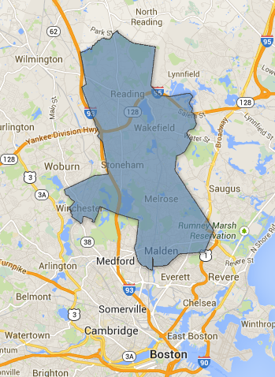
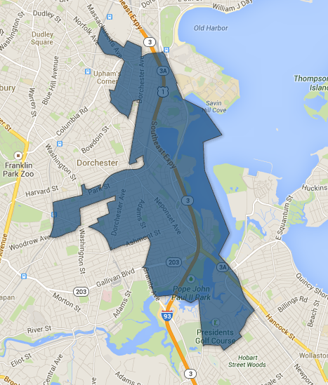
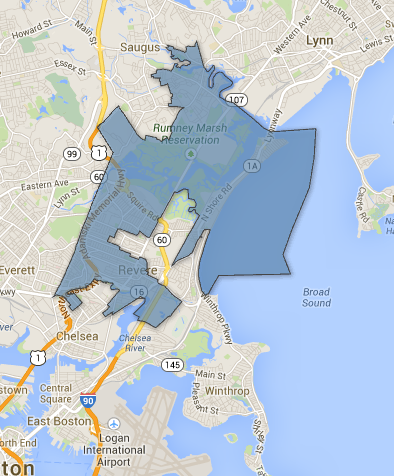
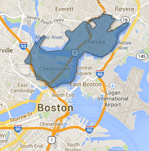

::: {.callout-note appearance="simple"}
Originally published on the [Mass. Numbers Blogger site](https://massnumbers.blogspot.com/2014/03/a-rundown-of-five-march-4-special-state.html) on 2014-03-02.
:::

On Tuesday, March 4 there will be five special state primaries: one to fill Katherine Clark's State Senate seat, and four to fill the State Representative seats of Donald Humason (recently elected to the State Senate), Kathi-Anne Reinstein (left for the private sector), Marty Walsh (recently elected Mayor of Boston), and Eugene O'Flaherty (serving as Boston Corporate Council under Walsh). The primaries are uncontested for the Humason seat, but the winner of the remaining Democratic primaries will likely win the general election.

**5th Middlesex Senate**

The 5th Middlesex State Senate seat was held by Katherine Clark, who was elected to the U.S. Congress to replace Ed Markey, who was elected to the U.S. Senate to replace Secretary of State John Kerry. The ripple effects continue as State Representatives Christopher Fallon and Jason Lewis face HomeStart non-profit director Anthony Guardia in the Democratic primary. Alderman Monica Medeiros is unopposed in the Republican primary.

| Candidate | Pty | City/Town | Position | Fundraising |
|---|---|---|---|---|
| [Christopher Fallon](http://fallonforsenate.com/) | D | Malden | State Representative | $61,350 |
| [Anthony Guardia](http://www.anthonyguardia.com/) | D | Wakefield | Director of HomeStart non-profit | $21,795 |
| [Jason Lewis](http://electjasonlewis.com/) | D | Winchester | State Representative | $146,908 |
| [Monica Medeiros](https://www.facebook.com/voteMonica) | R | Melrose | Alderman | $6,618 |

President Obama carried the 5th Middlesex District by 20 points and Elizabeth Warren defeated Scott Brown by 2 points in the district, making this seat unlikely to fall into Republican hands.

Rep. Lewis has a strong fundraising advantage over Rep. Fallon. In addition, the Democratic primary voting electorate will likely be more favorable to Lewis's ideology. Fallon had the dubious distinction of supporting Scott Brown over Elizabeth Warren for Senate and Fallon has a much more conservative voting record than Lewis. The one disadvantage for Lewis is the small overlap of his hometown of Winchester—only about 7% of the district votes—while Fallon's home town of Malden has about 27% of the 5th Middlesex votes.

Looking at all of the factors, Jason Lewis is the favorite. The winner of the Democratic primary should not have a problem winning the general election unless there is some strange and unexpected revelation.

**13 Suffolk State Representative**

There are five Democratic candidates and no Republican candidates for the 13 Suffolk primary to replace newly-elected Boston Mayor Marty Walsh, virtually guaranteeing that Tuesday's winner will be the general election winner.

| Candidate | Pty | City/Town | Position | Fundraising |
|---|---|---|---|---|
| [Liam Curran](http://www.voteliamcurran.org/) | D | Boston | City of Boston Attorney | $22,387 |
| [Gene Gorman](http://www.gormanforrep.com/) | D | Boston | Emerson College Professor | $9,795 |
| [Daniel Hunt](http://www.danhunt.org/) | D | Boston | MSBA Project Analyst | $104,568 |
| [Paul McCann Jr.](http://www.pjmccann.org/) | D | Boston | Boston Public Health Attorney | $15,070 |
| [John O'Toole](http://twitter.com/Otooleforrep) | D | Boston | City Council Candidate, Plumber | $25,245 |

While this is a particularly strong field of candidates, Daniel Hunt has a big enough fundraising advantage to be considered the favorite. The Dorchester district, like much of Boston, is incredibly Democratic with Obama winning the district by 53 points, and Elizabeth Warren by 40 points.

**4th Hampden State Representative**

There is only one candidate in each of the Democratic and Republican primaries to fill Republican Donald Humason's seat who was elected to the State Senate in November. Democratic candidate John Velis is a recently retired Army Captain and attorney who will face off against Republican City Councilor Dan Allie. President Obama won the 4th Hampden District by 6 points, but Elizabeth Warren lost it by 13 points, making this seat winnable by either party.

| Candidate | Pty | City/Town | Position | Raised |
|---|---|---|---|---|
| [John Velis](http://www.velisforstaterepresentative.com/) | D | Westfield | Army Captain (Ret.), Attorney | $9,740 |
| [Dan Allie](http://www.danallie.com/) | R | Westfield | City Councilor | $10,960 |

**16th Suffolk State Representative**

Revere State Representative and Assistant Majority Leader Kathi-Anne Reinstein resigned in January to take a position with the Boston Beer Company. There are three Democratic candidates running in the primary and Reinstein Chief-of-Staff Roselee Vincent has shown fundraising power and has received endorsements from groups like the Massachusetts Women's Political Caucus—she can be considered the favorite.

| Candidate | Pty | City/Town | Position | Fundraising |
|---|---|---|---|---|
| [Joshua Monahan](http://www.joshmonahan.com/) | D | Chelsea | Attorney | $6,718 |
| Linda Rosa | D | Revere | Former Bob Travaglini staffer | $5,100 |
| [Roselee Vincent](http://www.roseleeforrep.com/) | D | Revere | Reinstein staffer | $42,598 |
| [Todd Taylor](https://www.facebook.com/ToddTaylorForRep) | R | Chelsea | Staffing company owner | $7,115 |

The 16th Suffolk District went for Obama by 28 points and Warren by 14 points, so the Democratic winner should prevail in the general election on April 1.

**2nd Suffolk State Representative**

Chelsea State Representative and Judiciary Committee Chair Eugene O'Flaherty left the State House for City Hall, becoming the chief lawyer for Boston Mayor Marty Walsh. There are three strong candidates to replace O'Flaherty.

| Candidate | Pty | City/Town | Position | Raised |
|---|---|---|---|---|
| [Roy Avellaneda](http://www.royforrep.com/) | D | Chelsea | Former City Councilor | $28,460 |
| [Christopher Remmes](http://www.remmes.org/) | D | Boston | Realtor | $49,897 |
| [Daniel Ryan](http://www.danryanforrep.com/) | D | Boston | Capuano District Aide | $47,360 |

It is not at all clear who will win this primary and become the next State Representative for the 2nd Suffolk District. While Avellaneda had the smallest fundraising haul, he received a [ringing endorsement from the Boston Globe](http://www.bostonglobe.com/opinion/editorials/2014/02/27/avellaneda-best-choice-for-second-suffolk/jq3RqWwRpv50PoCdUYW9MP/story.html).
