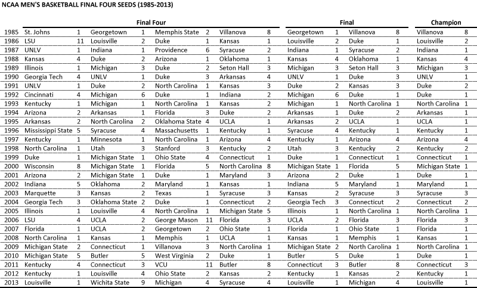
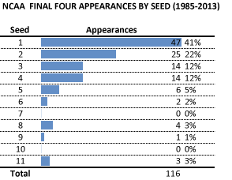
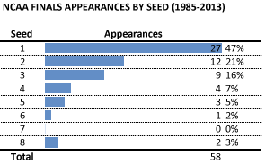
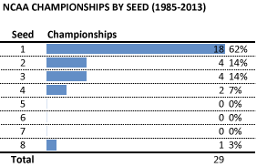
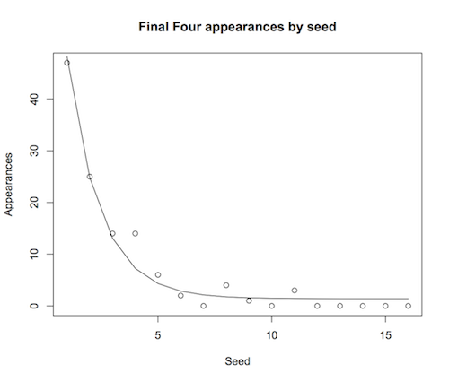
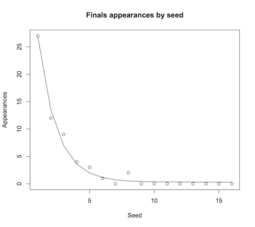
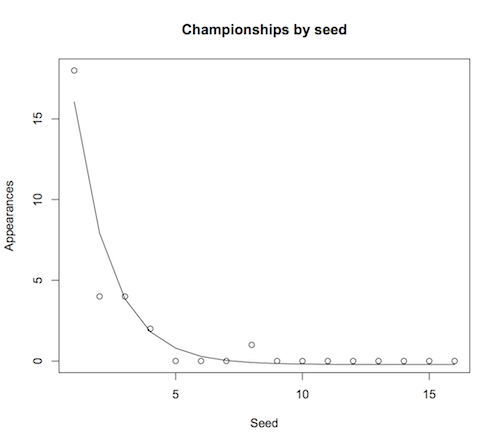

::: {.callout-note appearance="simple"}
Originally published on the [Mass. Numbers Blogger site](https://massnumbers.blogspot.com/2014/03/a-comprehensive-history-of-ncaa-mens.html) on 2014-03-17.
:::

I am taking my once-a-year break from writing about Massachusetts politics to write a sports analytics column, this one looking at how often teams with various seeds end up in the NCAA Men's Basketball Final Four and go on to win the championship.

While working on your bracket you may be asking yourself questions like, "Should I pick all number one seeds to go to the Final Four?," or "Should I only pick long shots to have a better chance differentiating myself from my bracket pool?" While I don't have definitive answers to these questions, it is instructive to look at how many teams of each seed have made appearances in the Final Four, have gone on to the final, and have won the national championship. This is a comprehensive history from 1985—the year the NCAA moved to a 64 team field—through last year's 2013 tournament.

There are a lot of 1s, 2s, 3s, and 4s in this table. In fact, out of the 116 teams that have made the Final Four since 1985, 100 have been teams with seeds 1 through 4, with only 16 teams having higher seeds. There has never been a team with a seed above 11 in the Final Four. It is important to note that this is likely to change as more games are played within this system—events with low probability *do* happen. However, teams with the lowest seeds are much more likely to make the Final Four.

Let's break this down by round. Here is a table of appearances in the Final Four by seed.

Of the 116 teams that have made the Final Four since 1985, 47 (41%) have held the top seed, 25 (22%) the 2 seed, 14 (12%) have been 3 seeds, and 14 (12%) have been 4 seeds. The remaining 16 teams (14%) have had seeds from 5 through 11. While it may seem mysterious that a 7 seed or a 10 seed has never made the Final Four, we are dealing with a sample size of only 116 and with a percentage that would likely be in the very low single digits—it is likely just a matter of chance. Later we perform a regression that gives us a feel for what expected frequencies for each of the seeds might be.

The median seed for this set of 116 Final Four seeds is 2, the mean of the seeds is 2.68, with a standard deviation of 2.26.

If we consider the seeds of the teams that have made the final championship game, the highest seed is 8 (compared to 11 in the Final Four). There is a drop off from the 1 seed to the 2 seed similar to that in the Final Four round, and only 10% of the teams had a seed below 4. The two 8-seeded teams that made the final game were Villanova in 1985—who went on to win the championship game in spectacular fashion against top-seeded Georgetown—and Butler in 2011. The 2011 Butler team lost to 3-seed Connecticut 53-41.

The median seed of this set is again 2, and the mean of the seeds has inched down to 2.26, with a standard deviation of 1.69.

The seeds of the teams that have won the NCAA championship since 1985 are an exclusive set, with only the 1985 Villanova team having a seed greater than four. Well over half the teams that have won the championship (62%) have been 1 seeds. There have been 4 teams (14%) that were 2 seeds, and 4 teams (14%) that were 3 seeds.

The two teams with 4 seeds that won the championship were Danny Manning's 1988 Kansas team, and the 1997 Arizona Wildcats who came back twice from 10 point deficits in earlier rounds. The median of the championship seeds is 1, the mean is 1.86, and the standard deviation is 1.53.

The seed data from all of the rounds comes remarkably close to fitting an exponential decay regression of the form (1/2)^seed. Here are the same data with a fitted regression line. The regression lines indicate some possible outliers like over-performing 4 seeds in the Final Four, and underperforming 2 seeds for the final championship.

The 28 years of NCAA 64-team-bracket historical data show clearly that choosing a team with a seed greater than 4 to go all the way and win the championship is hoping for a true long shot. However, chances are that a 5 or 6 seed will win a championship if the tournament continues in its current form.
