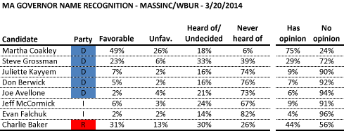
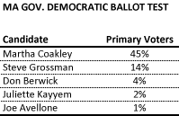
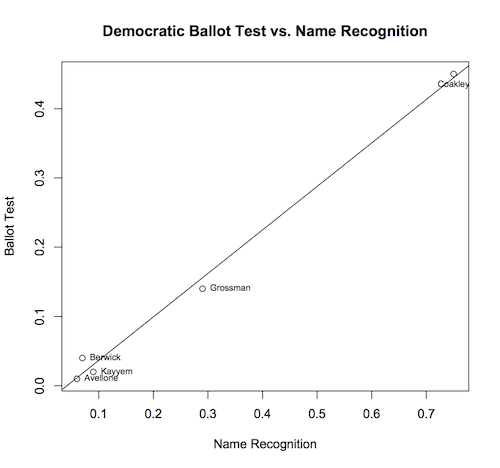

::: {.callout-note appearance="simple"}
Originally published on the [Mass. Numbers Blogger site](https://massnumbers.blogspot.com/2014/03/polling-of-massachusetts-governors-race.html) on 2014-03-21.
:::

On Thursday, March 20 the MassINC Polling Group released [a new poll of the Massachusetts Governor's race](http://www.wbur.org/2014/03/20/coakley-leads-governors-race) commissioned by WBUR. While WBUR led with Attorney General Martha Coakley maintaining a large lead in the race, the most important aspect of the poll—the continuing low name recognition of the non-Coakley candidates—was only covered in passing in comments by pollster Steve Koczela in the on-air interview.

In fact, the performance of the Democratic candidates on the Democratic Primary ballot test is defined, and drastically limited, by low name recognition, as the following charts and graph will show. These early polls give us very little information about how these candidates will fair in the September primary or November general election after voters begin to pay attention to the race and get to know and differentiate between the top-tier candidates.

The key number is the 75% of respondents that have an opinion of Martha Coakley, which is the driver for her performance in the primary ballot test against the other Democrats, and in her 41% to 26% lead over Charlie Baker in the general election ballot test. Charlie Baker and Steve Grossman are the next closest candidates with 44% and 29% respectively. The remaining candidates are largely unknown to Massachusetts voters.

The next chart shows the share of the respondents that said they would vote for each of the candidates in the Democratic primary.

There is a strong correlation between the Democratic Primary ballot test percentages and the *Has opinion* column in the name recognition chart. A linear regression between the ballot test percentage and the name recognition percentage shows the strength of this relationship. While the amount of data is small, you would expect candidates to be well above or below the line if they were over- or under-performing within the pool of voters who knew them.

Martha Coakley's name recognition, combined with her favorable/unfavorable numbers are a positive sign for her prospects in the fall elections, and at some point low name recognition will be a problem for the lesser-known candidates. However, history points towards an tightening of the race as candidates who build statewide organizations have an opportunity to make their case to the voters when the election moves into its next stage and voters are actually paying attention.
