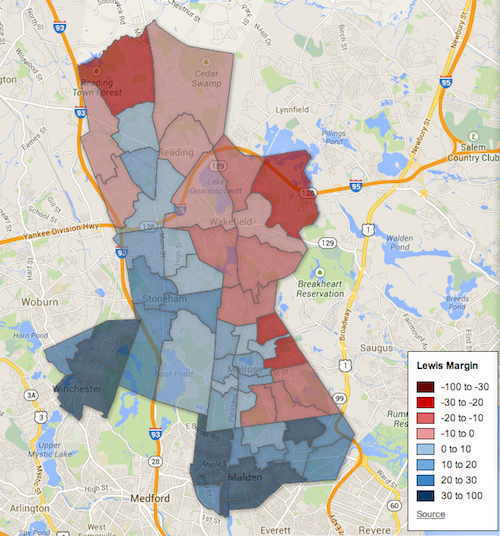
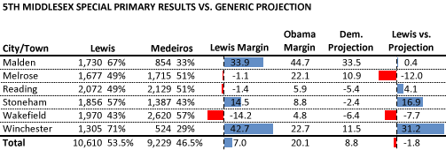
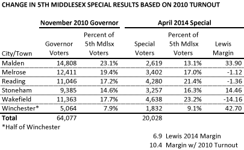

::: {.callout-note appearance="simple"}
Originally published on the [Mass. Numbers Blogger site](https://massnumbers.blogspot.com/2014/04/the-april-1-special-election-surprise.html) on 2014-04-06.
:::

Democratic candidates [swept the special state elections](http://www.bostonglobe.com/metro/2014/04/01/democrats-win-house-seats-formerly-held-walsh-flaherty/CNfQi3rY7nC4RWtrvPyqgO/story.html) on Tuesday, April 1, with the biggest surprise coming from Democratic newcomer [John Velis's victory](http://www.masslive.com/news/index.ssf/2014/04/democrat_john_velis_defeats_re_27.html) over Republican Dan Allie to represent the 4th Hampden State Representative District. The Westfield seat had been vacated by Republican and now-State Senator Donald Humason and held by the GOP for 36 years.

Less surprising was State Representative Jason Lewis's (D-Winchester) win over Republican Melrose Alderman Monica Medeiros in a special election to replace Congresswoman Katherine Clark as State Senator for the 5th Middlesex District. Lewis had 10,610 votes (53.5%) to Medeiros's 9,229 votes (46.5%). Lewis's 7 point margin (compared to Clark's 4.6 point margin in her 2010 win over Craig Spadafora) points toward a strong campaign, combined with a 2011 redistricting that made the district more Democratic.

Recent election results led me to predict a likely Democratic win in the 5th Middlesex in my [overview of the March 4 primaries](../2014-03-02-march-special-state-primaries/index.qmd). I received [pushback](https://twitter.com/GittleBos/status/440624958121988096) because a previous version of the district was held by a Republican for 20 years. [Analysis showed a redistricting shift to the left by about 4 points](../2014-03-09-fifth-middlesex-likely-blue/index.qmd), but there was additional pushback about [using presidential results as a baseline for the shift](http://www.redmassgroup.com/showComment.do?commentId=120763). However, even a cursory analysis of the redistricting points towards a move to the left from the Middlesex and Essex District—held by 20 years by Republican Richard Tisei—to the 5th Middlesex District. While this district could be won by a strong GOP candidate who outworked and out-raised a Democratic nominee, Lewis's increased margin should not come as a big surprise.

**5th Middlesex special election results**

The 5th Middlesex State Senate District consists of Malden, Melrose, Reading, Stoneham, Wakefield, and half of Winchester. A precinct-by-precinct look at the April 1 results shows Representative Lewis winning all precincts in Malden, Winchester, and Stoneham, the central precincts of Reading, and the western precincts of Melrose. Alderman Medeiros won the outer precincts of Reading, all of Wakefield, and the eastern precincts of Melrose.

**PRECINCT-BY-PRECINCT MARGINS (click for interactive version)**

::: {.callout-note appearance="simple"}
The interactive version of this map was built with Google Fusion Tables, which
Google shut down on 3 December 2019. Only the static image survives.
:::

My [Democratic projection for the 5th Middlesex precincts](../2014-03-09-fifth-middlesex-likely-blue/index.qmd) was arrived at by comparing President Obama performance in the old district (normalized against the state average) in 2008, to his performance in the new district (again normalized against the state average) in 2012, showing a shift of 4.2 points to the left (not surprising given the removal of the very conservative Lynnfield, and the addition of more liberal precincts in Winchester and Melrose). Adding this 4.2 point shift to Katherine Clark's 4.6 margin, gave us a projected 8.8 point win by a strong Democrat—similar to Clark—in the new 5th Middlesex.

**Variation by city and town**

Representative Lewis did not quite achieve an 8.8 point margin of victory. While there are probably many factors involved, there is evidence that there was a hometown affect in Melrose and Winchester. Political candidates often perform better in their hometown, especially when their hometown or city is listed next to their names on the ballot, as is done in Massachusetts elections. Alderman Medeiros did better than our simplistic expectations in her hometown of Melrose and Lewis outperformed in his town of Winchester. However, only half of Winchester is in the 5th Middlesex Senate District—only 9% of the April 1 vote came from Winchester—while 17% of voters came from Melrose. In addition, low turnout elections like the April 1 special election tend to draw older voters who are more conservative, on average.

While the hometown affect is likely to explain Mederios's performance in Melrose, and Lewis's in Winchester, the other municipalities that differ from expectations are Stoneham (which was about 17 points more Democratic than expected by the naive model) and Wakefield (which was about 8 point more Republican than expected). Lewis's strong performance in Stoneham is likely due to the fact that he represented all but one precinct of Stoneham as State Representative—most Stoneham voters have seen Lewis on the ballot since 2008. The reason for Medeiros's strong performance in Wakefield is less clear. One possibility could be the loss of Wakefield native and former School Committee Chair Anthony Guardia to Lewis in the March 4 primary, but there is little evidence to support that supposition.

**November rematch prospects**

Alderman Medeiros [has indicated](https://www.facebook.com/voteMonica) she is encouraged by her showing in the special election and is reviewing her plans for Fall accordingly, presumably meaning she is considering challenging Lewis again in the November general election. While there is plenty of time for circumstances to change before November and the top of the Democratic ticket for Massachusetts Governor has yet to be determined, a general election electorate should be slightly more favorable to Lewis, meaning an even bigger uphill climb for Mediros in November.

*Addendum made on 4/8/2014:*

A close look at the turnout from each of the 5th Middlesex cities and towns on April 1 compared to the November, 2010 turnout statewide gubernatorial election (which is closer to what we would see in a November, 2014 rematch with Medeiros) looks to provide a much bigger buffer to Jason Lewis. The model estimates a 10.4 point win by Lewis given the April 1 margins in each municipality combined with a turnout like November, 2010.

