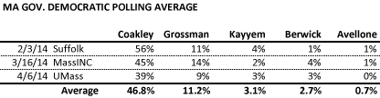
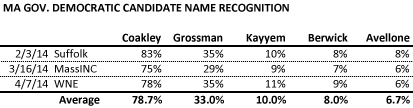
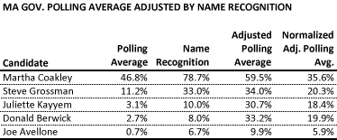

::: {.callout-note appearance="simple"}
Originally published on the [Mass. Numbers Blogger site](https://massnumbers.blogspot.com/2014/04/adjusting-ma-governor-polls-for-name.html) on 2014-04-17.
:::

Polling of the Democratic primary for the Massachusetts Governor's race has [been defined](../2014-03-21-governor-polling-unknown-candidates/index.qmd) by strong name recognition and performance by Attorney General Martha Coakley, and much lower name recognition for the remaining four candidates: Treasurer Steve Grossman, Juliette Kayyem, Donald Berwick, and Joe Avellone. Adjusting the poll results for name recognition still shows Coakley outperforming the other candidates, but also reveals a bunched second tier—Grossman, Kayyem, and Berwick—with Avellone trailing well behind the others.

An average of the last three polls of the Massachusetts gubernatorial race shows Martha Coakley with a commanding lead of 47%, followed by Steve Grossman at 11%, Juliette Kayyem just above 3%, Donald Berwick just under 3%, and Joe Avellone below 1%. However, it is difficult to interpret these poll results given the name recognition of well below 50% for four of the five candidates, as seen in the second table.

There is some precedent, at least in Presidential primaries, for candidates who start with very low name recognition to become the eventual nominee and election winner ([think Jimmy Carter](http://fivethirtyeight.com/features/a-brief-history-of-primary-polling-part-ii/)). However, Presidential primary history also shows that [strong early polling performance often portends electoral success](http://fivethirtyeight.com/features/a-brief-history-of-primary-polling-part-iii/). A measured analysis gives credit to well-known and well-liked candidates, while also acknowledging the potential of lesser-known candidates to break through and succeed, albeit with a smaller probability of success.

Nate Silver, in his [analysis of Presidential primary polling](http://fivethirtyeight.com/features/a-brief-history-of-primary-polling-part-i/), introduces the concept of a *Recognition-Adjusted Polling Average* where the polling average is divided by the name recognition, showing us the percentage of respondents that recognized the candidate, who also supported that candidate. For example, since 10% of survey respondents have an opinion of Juliette Kayyem, and 3.1% of the total number of respondents chose Kayyem in a ballot test, we know that about 31% of the people who know Juliette Kayyem also support her as their first choice for the Democratic nomination. The following table computes the recognition-adjusted polling average for each candidate, and then normalizes the results to add up to 100% in this zero-sum electoral contest.

The recognition-adjusted average still shows Attorney General Coakley with a commanding lead of 15 points over her competition, with Grossman, Kayyem, and Berwick clustered around 20%, and Joe Avellone in a distant fifth place with about a 6% share.

It is not appropriate, however, to take these recognition-adjusted polling numbers as a prediction for the eventual primary result. Rather, these numbers are more of an indication of potential of what the lesser-known candidates can start to achieve if/when they break through and achieve more name recognition by a strong performance at the convention, or by some other means.

Early polls are important for establishing baselines, to understand the potential makeup of the electorate, and to give us a window into how voters feel about issues that may affect the race. However, news organizations often want to reduce these nascent results down to an electoral horserace interpretation, disregarding aspects like name recognition.

That being said, we are getting close to the point in the Massachusetts gubernatorial race where low name recognition can no longer be used as an excuse by the lesser-known candidates, and where it must be treated as something that must overcome to have a shot at victory in September. Each of the candidates need to win 15% of the total delegates at the Democratic State Convention in June to make the primary ballot, and a strong showing at the convention may also be needed to boost candidate visibility with the Democratic primary electorate who will pick their nominee on September 9.
