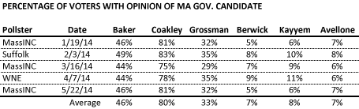
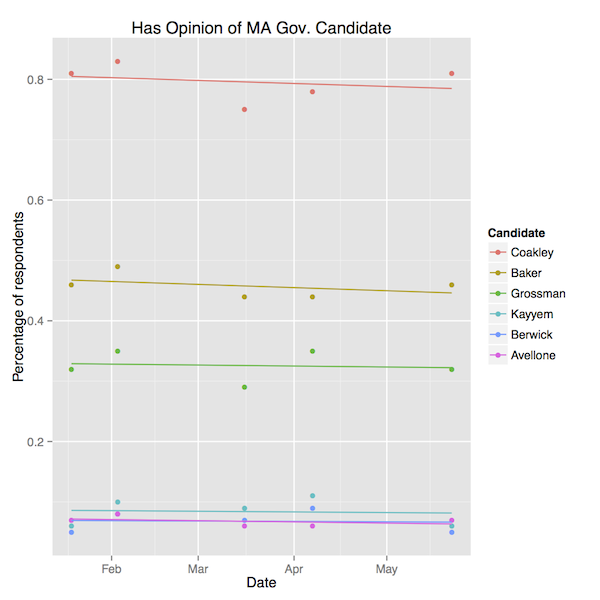
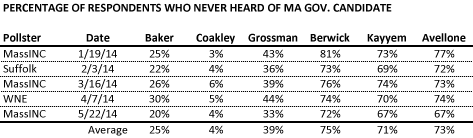
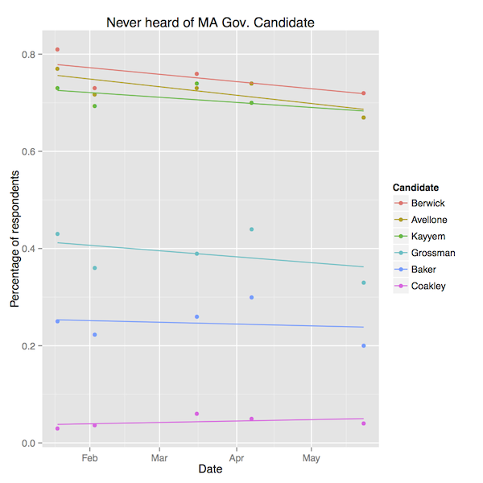

::: {.callout-note appearance="simple"}
Originally published on the [Mass. Numbers Blogger site](https://massnumbers.blogspot.com/2014/05/new-poll-in-massachusetts-governors.html) on 2014-05-23.
:::

The MassINC Polling Group [survey of 503 likely voters](http://www.wbur.org/2014/05/22/poll-coakley-frontrunner) conducted from May 16 to 18 for WBUR showed no increase in the number of voters that had an opinion of the Democratic and Republican candidates for Massachusetts Governor when compared to previous surveys from this year. There was a very slight decrease in the percentage of respondents who said they had never heard of each candidate, except Attorney General Martha Coakley.

Here are the summarized results from the all of this year's public polls with the percentage of respondents that have a favorable or unfavorable view of each candidate. These numbers have been remarkably stable in the past five months. The candidates with single digit name recognition have a great deal of ground to make up in the next several months, presumably by a strong showing at the Democratic State Convention in June. However, these candidates [have much lower name recognition than Deval Patrick](http://www.massincpolling.com/?p=1715) had at a similar time in his first election cycle, a previous example of a candidate who made up a lot of name recognition ground very quickly.

If we look at the percentage of survey respondents who say they have never heard of each candidate—a slightly lower bar to get over than actually having a favorable or unfavorable opinion—there does seem to be a slight improvement for every candidate, except Attorney General Coakley. However, the never-heard-of numbers are decreasing at a very slow rate, not nearly fast enough to get the lesser-known candidates to where they need to be for the September primary.

*Updated May 23 with fix to Coakley's never-heard-of percentage in latest MassINC poll.*
