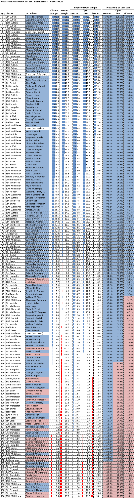
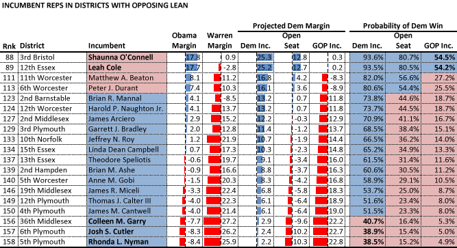
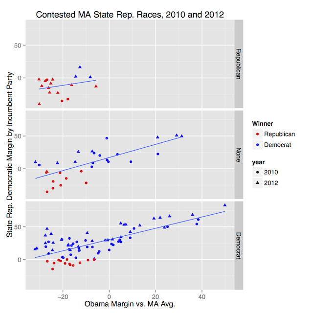
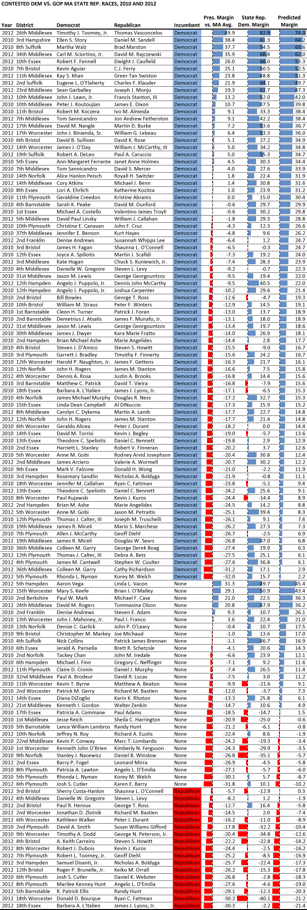

::: {.callout-note appearance="simple"}
Originally published on the [Mass. Numbers Blogger site](https://massnumbers.blogspot.com/2014/05/an-updated-partisan-ranking-of.html) on 2014-05-27.
:::

There are 160 State Representative Districts in Massachusetts—127 of the seats are held by Democrats, 29 are held by Republicans, and 4 are vacant. This article provides a ranking of all 160 districts from the deepest blue Democratic 6th Suffolk District of Russell Holmes in Boston, to Rep. Brad Jones's GOP stronghold in the 20th Middlesex District. I also provide a regression model that does a good job of explaining the vote margin between Republican vs. Democratic match-ups, using the Obama vote share in the district, and whether there is a Democratic or Republican incumbent in the race.

In [my first partisan ranking of State Representative districts](../2012-11-18-house-district-partisan-ranking/index.qmd), I took a simple average of Democratic vs. Republican margins in the district for statewide candidates to determine the ranking. The ranking was somewhat limited by lack of precinct-by-precinct results for all districts. A finer-grained analysis of the Massachusetts towns and districts is made possible by the outstanding [election statistics site](http://electionstats.state.ma.us/) published by the Massachusetts Secretary of State and built by [Adam Friedman](http://adamfriedman.org/), which provides precinct-by-precinct results for Massachusetts elections. I was able to look for relationships between historical State Rep. race results, statewide candidate vote margins, and other factors, and found that the best predictors of State Rep. results were President Obama's margin in the district, combined with the State Rep. incumbency status. The resulting regression model allows for rough predictions of vote margins and win probabilities in contested Democrat vs. Republican State Rep. races.

The big takeaways from the model are that Democrats are doing better in GOP-leaning districts, than Republicans are doing in Democratic-leaning districts, and that incumbency means a great deal. An incumbent candidate of either party gets, on average, a 12 point increase in margin compared to a non-incumbent. An open race without an incumbent is the best way to flip a seat as we saw in the 4th Hampden special election on April 1, 2014, where Democrat John Velis was able to win in a district which had been held by Republican Donald Humason for 10 years.

The results are summarized in the following table ordered from most Democratic to most Republican. The table includes the expected Democratic margin in the district for each incumbency case, and then the probability of a Democratic win for each incumbency case.

There is a lot of blue at the top of the table and you need to get down to row 115 before find a district where the model shows a 50/50 race for an open seat—the 10th Worcester District of Democratic Rep. Dennis Rosa. Republicans Shauna O'Connell and Leah Cole have beaten the odds by getting elected in the Democratic leaning 3rd Bristol and 12th Essex Districts, which President Obama won by almost 18 points. On the other side of the coin, Democratic Representatives Colleen Garry, Josh Cutler, and Rhonda Nyman have defied the odds in districts where the President lost by around 8 points and where the model gives an incumbent Democrat a less than 40% chance of winning against a challenging Republican.

[](https://docs.google.com/spreadsheets/d/13y5sVnaJJsh87Gyo9qoIjkTuhieQ9odle0_PvY1f0OE/edit?usp=sharing)

Let's take a look at incumbents who have succeeded in unlikely district. In 19 of the 160 districts the incumbent's party is predicted to have a less than 50-50 chance to win the district in an open race. Four of those incumbents are Republicans and 15 are Democrats. All of these Representatives have, at some level, beaten the odds to get elected in a challenging district.

Four of those incumbents—the already mentioned GOP Reps Shaunna O'Connell and Leah Cole, and three Democratic Reps Colleen Garry, Josh Cutler, and Rhonda Nyman—are actually in districts where the regression model predicts average incumbent of their party would lose to a challenger of the other party. It is clear that candidates can, and do, win in unfavorable partisan climates due to factors like a particularly strong campaign, a weak opponent, holding positions associated with the other party, or a particularly long service to the community, among other factors.



The following map allows for interactive exploration of the districts. The shading is based on the probability of a party's win in an open race.

```{r}
#| column: body-outset
#| fig-height: 6

library(tidyverse)
library(sf)
library(tmap)

tmap_mode("view")

# Two header rows in the spreadsheet: a group row (projected margin,
# probability of a Democratic win) above the column names.
ranking <- read_csv("state_rep_ranking.csv", skip=1, show_col_types=FALSE,
                    name_repair="unique_quiet") |>
    filter(!is.na(Rnk)) |>
    transmute(REP_DIST=recode(District, "Bstble, Dukes, Ntct"="Barnstable, Dukes and Nantucket"),
              District, Rank=Rnk, Incumbent,
              obama=`Obama Margin`,
              open_margin=`Open Seat...7`,
              open_prob=parse_number(`Open Seat...11`))

districts <- read_sf("../../_gis/house2012/HOUSE2012_POLY.shp") |>
    st_transform(4326) |>
    select(REP_DIST) |>
    left_join(ranking, by="REP_DIST")

tm_shape(districts) +
    tm_polygons(
        fill="open_prob",
        fill.scale=tm_scale_continuous(values=c("#FF4949", "white", "#0F4392"),
                                       midpoint=50, limits=c(0, 100)),
        fill.legend=tm_legend(title="Dem. win probability, open seat (%)"),
        fill_alpha=0.7,
        col_alpha=0.3,
        id="District",
        popup.vars=c("Rank"="Rank", "Incumbent"="Incumbent",
                     "Obama margin"="obama",
                     "Projected Dem. margin, open seat"="open_margin",
                     "Dem. win probability, open seat (%)"="open_prob")) +
    tm_basemap("OpenStreetMap")
```

::: {.callout-note appearance="simple"}
**This map was rebuilt in 2026.** The original interactive map was made with
Google Fusion Tables, which Google shut down on 3 December 2019. This version is
drawn from the State Rep. district partisan ranking spreadsheet linked below,
using its open-seat win probabilities, on the 2012-2022 House district
boundaries. Incumbents are as of May 2014.
:::

**Explanation and analysis**

The identification of presidential margin and incumbency status as key predictors of State Rep. election results was done using [regression analysis](http://en.wikipedia.org/wiki/Regression_analysis). This table shows the relationship between State Rep. race margin and Presidential race margin (normalized agains the Massachusetts average) for each incumbency status, and also shows the regression line which best approximates the relationship between the variables.



Each point on the regression graph is a line in the table below of the 2010 and 2012 State Representative races which had both a Republican and a Democrat. The analysis ignores third-party and independent candidates and looks only at the two-party vote share and margin. The table is sorted first by a classification as to whether there was a Democratic incumbent, no incumbent, or a Republican incumbent, and then by President Obama's margin in the district (negative for a loss), normalized by subtracting the President's margin for all of Massachusetts. This normalization allows for some kind of comparison between the 2008 results (which are used for the 2010 races) and the 2012 results (used for the 2012 races). The *Predicted Margin* column shows the State Rep. margin as predicted by the regression line.

[](https://docs.google.com/spreadsheets/d/1-1Mj3U1SwZvIkXKCM_0eyLwnkz7-DqDhVOggROxwZ50/edit?usp=sharing)

**Supporting data**

These online documents contain searchable, sortable, and downloadable data used for this analysis:

- [State Rep. district partisan ranking spreadsheet](https://docs.google.com/spreadsheets/d/13y5sVnaJJsh87Gyo9qoIjkTuhieQ9odle0_PvY1f0OE/edit#gid=1813261438)

- [Contested State Rep. races results 2010, 2012](https://docs.google.com/spreadsheets/d/1-1Mj3U1SwZvIkXKCM_0eyLwnkz7-DqDhVOggROxwZ50/edit#gid=200655386)

- Interactive Map of State Rep. district partisan rankings

::: {.callout-note appearance="simple"}
The interactive map in this list was published with Google Fusion Tables and is
no longer available; the map above is rebuilt.
:::
