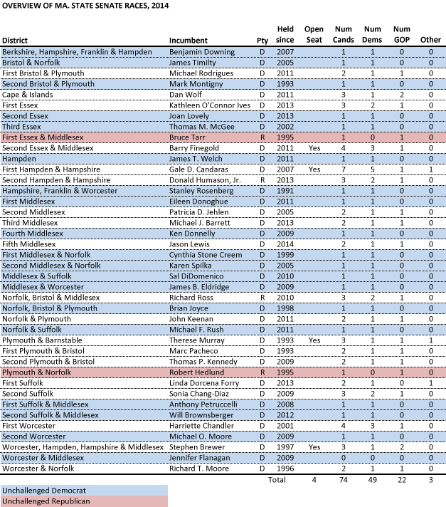
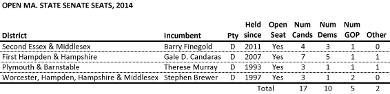
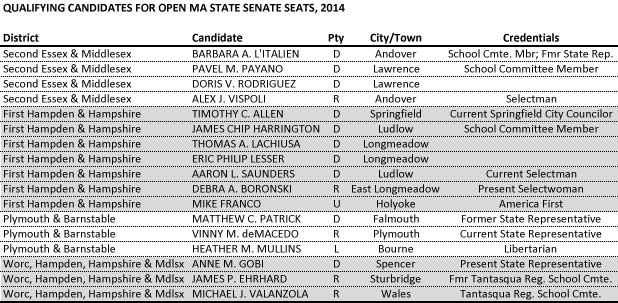
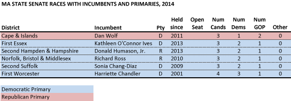
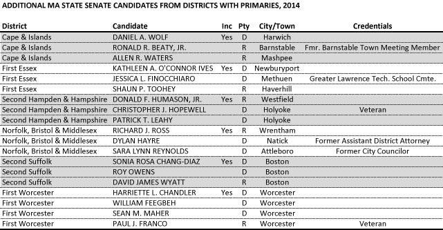
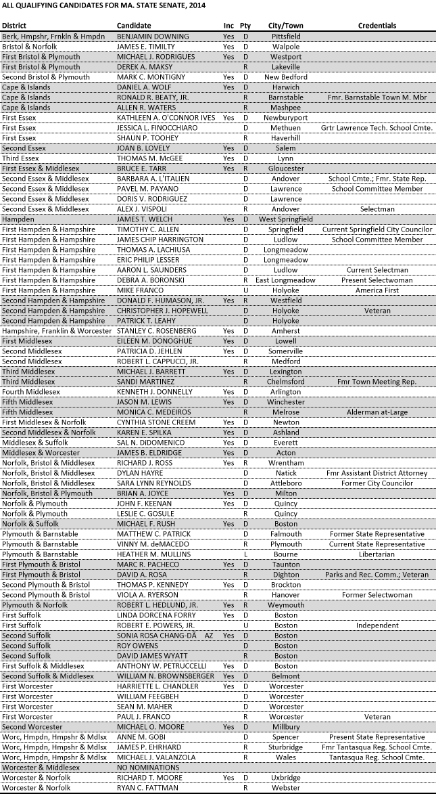

::: {.callout-note appearance="simple"}
Originally published on the [Mass. Numbers Blogger site](https://massnumbers.blogspot.com/2014/06/an-overview-of-2014-massachusetts-state.html) on 2014-06-03.
:::

On Thursday, May 29, the Massachusetts Secretary of State released the [list of County and District candidates](https://docs.google.com/spreadsheets/d/143tkbOE4RaRdBnx5OQGHw_E8-Qgk8eW3T5tY56fBEGg/edit#gid=1521632076) who qualified for the primary or general election ballot in 2014. This article breaks down that list and gives a high-level overview of the races and candidates for State Senate, which will be followed by an overview of the races for State Representative in an upcoming article.

There are 40 State Senate seats in Massachusetts, currently held by 36 Democrats and 4 Republicans. For this election cycle, 74 candidates have qualified for the ballot, made up of 49 Democrats, 22 Republicans, and 3 independent or unenrolled candidates. There are four sitting State Senators not seeking re-election and nine seats that have at least one major party primary.

There is an increase in contested races in 2014 over 2012, with 19 out of 40, or 48% of the State Senate seats having at least one challenger this year, compared to 16/40 (40%) in 2012. The following chart shows each State Senate district, the sitting incumbent, whether the seat is open (i.e. the incumbent is not running for re-election), and the number of candidates from each party that has qualified for the ballot. The uncontested races are shaded blue for Democratic incumbents and red for GOP incumbents.

No candidate has qualified for the Worcester & Middlesex District represented by Senator Jen Flanagan, after a large number of Sen. Flanagan's nomination signatures were disallowed because the nomination papers were missing the candidate's city of residence. Flanagan is planning to run a sticker campaign for the primary and should have no problem getting 300 primary votes to qualify for the general election ballot.

This interactive map shows uncontested races in blue and red and uses darker shades of green for contested seats with larger numbers of candidates.

::: {.callout-note appearance="simple"}
**The interactive map that appeared here is no longer available.** It was built
with Google Fusion Tables, which Google shut down on 3 December 2019, and no
image of it or copy of its table survives. As the sentence above describes, it
showed each of the 40 State Senate districts, with uncontested seats in blue and
red and contested seats in shades of green that darkened with the number of
candidates. The chart above lists the same races and candidate counts.
:::

**Open Seats**

Four sitting State Senators are not running for re-election. Sen. Barry Finegold is running for State Treasurer, Sen. Gale Candaras is running for Hampden County Register of Probate, Senate President Therese Murray has been term-limited out of the Senate presidency and has decided not to run, and Senator Stephen Brewer is retiring.

An open seat creates an ideal opportunity new candidates to run for office, and also offer a much stronger chance for the non-incumbent party to flip the seat, so it is not surprising that 23% of the State Senate candidates are running for the 10% of the seats that are open. Each of these races features at least one Democrat and Republican, and two of the races also have third party candidates (America First and Libertarian).

The Second Essex & Middlesex seat features a three-way Democratic primary, including former State Representative Barbara L'Italien, who lost very close races for State Representative in 2010 and 2012.

The First Hampden & Hampshire District of Gale Candaras has the distinction of having seven candidates, the most of any State Senate race this year. There is a five-way Democratic primary, including former Obama White House Aide Eric Lesser. The race has a single Republican, and also an America First candidate, Mike Franco, who has run in the past as a Republican and [does not currently live in the district](http://www.masslive.com/politics/index.ssf/2014/06/michael_franco_seeks_state_sen.html).

There is no primary battle for Senate President Therese Murray's Plymouth & Barnstable seat, as there is a single Democrat, Republican, and Libertarian candidate. The Democrat is former State Representative Matt Patrick, and current GOP State Representative Vinny deMacedo is leaving the House to vie for this State Senate seat.

State Senator Stephen Brewer's Worcester, Hampden, Hampshire & Middlesex District has the longest district name, and is the only open race to feature a Republican primary between current and former Tantasqua Regional School Committee members James Ehrhard and Michael Valanzola. State Representative Anne Gobi has had success in a similarly conservative State Rep. district and is the only Democrat in the race.

**Race with incumbents and primaries**

We have already looked at the three opens seats that feature contested primaries, but there are an additional six seats that have both an incumbent and a primary. Three of the seats have a primary between non-incumbents, and three have the incumbent facing a primary challenge.

Two Republicans, Ronald Beaty and Allen Waters, are facing off in a Republican primary to challenge incumbent State Senator Dan Wolf in the general election—Wolf gave up his bid for Governor after the State Ethics Commission raised issues with his ownership of Cape Air. In a similar fashion, there are two Democrats facing off in both the Second Hampden & Hampshire and Norfolk, Bristol & Middlesex District primaries in order to challenge GOP State Senators Donald Humason and Richard Ross.

Three incumbent Democrats are facing primary threats. State Senator Kathleen O'Connor Ives is being challenged by fellow Democrat Jessica Finocchiaro, a School Committee Member and Massachusetts Young Democrats activist. State Senator Harriette Chandler faces a primary challenge from two Democrats, William Feegbeh and union candidate Sean Maher. State Senator Sonia Chang-Diaz is facing a primary challenge from Roy Owens, who is basing his candidacy on his opposition to abortion, giving him no chance to win in this incredibly liberal district. It has traditionally been very difficult to unseat a sitting state legislator in a primary without extenuating circumstances like a scandal, which we haven't seen in these races.

**All Candidates**

Here is the complete list of State Senate candidates who qualified for the ballot.

**Supporting materials**

- [Spreadsheet of all MA State Senate candidates](https://docs.google.com/spreadsheets/d/1Fb75sWX6ja4A6avTuTL7oegfpi1eIN0RQ6w3GWgXy54/edit?usp=sharing)

- [Spreadsheet of all MA candidates for County and District offices](https://docs.google.com/spreadsheets/d/1Fb75sWX6ja4A6avTuTL7oegfpi1eIN0RQ6w3GWgXy54/edit?usp=sharing)
